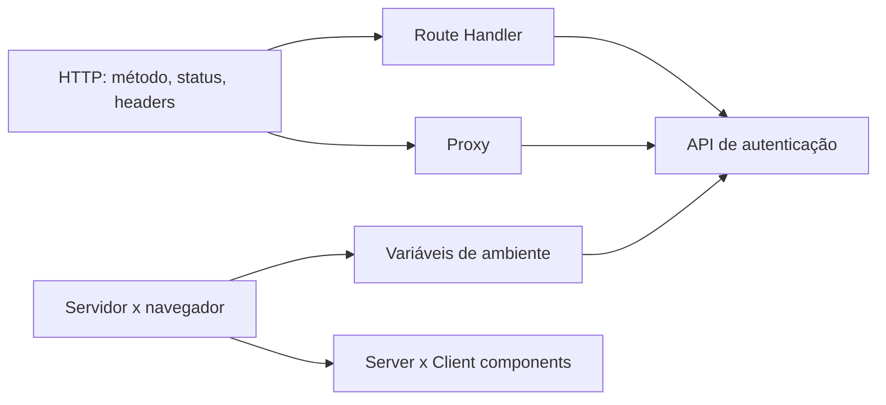

# Estudo: Next.js aplicado à segurança (Route Handlers, proxy, headers, env)

> **Área:** Segurança web / Next.js 16 (App Router) · **Tipo de conhecimento:** tecnologia + conceitual · **Nível assumido:** você já usa Next.js (páginas, componentes client/server) e HTTP, mas nunca escreveu API nem proxy no Next · **Tempo estimado:** 2 a 3 horas, em 2 sessões

**Arquivos do projeto que este estudo explica:** `app/api/auth/**/route.ts`, `app/api/auth/_lib/http.ts`, `proxy.ts`, `next.config.js`, `.env.local`/`.env.example`, `infrastructure/container.ts` e `infrastructure/server-container.ts`.

---

## 0. Antes de ler (5 minutos)

No tablet, sem consultar:

1. Qual a diferença entre uma página (`page.tsx`) e um Route Handler (`route.ts`)?
2. Se você bloqueia uma rota só escondendo o link no menu, ela está protegida? Por quê?
3. Uma variável de ambiente sem `NEXT_PUBLIC_` pode ir para o navegador?
4. Qual código HTTP usar para "não autenticado"? E para "já existe esse cadastro"?

---

## 1. Como estudar este tema

| Técnica | Como aplicar neste tema | Onde |
|---|---|---|
| Prever antes de executar | Antes de cada `curl` da seção 4.8, escreva o status e os headers esperados. | Terminal |
| Quebrar de propósito | Remova o cookie e acesse `/dashboard`; envie `Content-Type: text/plain` ao login; erre a senha 6 vezes; apague `SESSION_SECRET`. Anote cada resposta. | Terminal |
| Diagrama à mão | Desenhe o caminho de `GET /dashboard` e de `POST /api/auth/login` passando por `proxy.ts`, rota e domínio. | Tablet |
| Exemplo com lacunas | Exercícios da seção 7. | Tablet |
| Revisão seção por seção | Depois de estudar, volte ao documento e responda as perguntas de recuperação da seção 8, uma seção por vez, cobrindo o texto. | Tablet |

---

## 2. Visão geral

**Em uma frase:** o Next.js permite que o mesmo projeto tenha a interface **e** o backend de autenticação, e oferece pontos claros para proteger rotas (`proxy.ts`), responder APIs (`route.ts`), endurecer respostas (`headers()`) e guardar segredos (variáveis de ambiente).

**Em um parágrafo:** no projeto, o navegador nunca vê scrypt, AES nem o segredo da sessão. Isso roda em Route Handlers, no servidor. O `proxy.ts` é a "portaria": antes de renderizar uma página protegida, confere o cookie. O `next.config.js` adiciona cabeçalhos de segurança a toda resposta. E as chaves ficam em variáveis de ambiente, fora do código e do Git.

---

## 3. Fundamentos necessários



**3.1 Requisição e resposta HTTP.** Método (GET, POST), cabeçalhos, corpo e código de status. *Por que precisa:* toda a segurança aqui é decidida por esses elementos.

**3.2 Servidor x navegador.** Código de servidor tem acesso a segredos e ao sistema de arquivos. Código que vai ao navegador é público, qualquer um lê. *Por que precisa:* é a fronteira da segurança.

**3.3 Cookies e sessão.** Ver `estudo-jose-jwt.md`.

**3.4 Server e Client Components.** Componentes sem `"use client"` rodam só no servidor. Os com `"use client"` são enviados ao navegador.

---

## 4. O conceito em profundidade

### 4.1 Route Handlers (`route.ts`)

Um arquivo `route.ts` dentro de `app/` define um endpoint HTTP. Você exporta funções com o nome do método:

```ts
// app/api/auth/login/route.ts (simplificado)
export async function POST(request: Request) {
    const body = await readJsonBody(request)           // 1. lê e valida o corpo
    // ...valida, limita tentativas, verifica senha...
    const response = Response.json(sessionUser)        // 2. monta a resposta
    response.cookies.set(SESSION_COOKIE, token, sessionCookieOptions()) // 3. cookie de sessão
    return response
}
```

| Rota | Método | Função |
|---|---|---|
| `/api/auth/register` | POST | Cria usuário e inicia sessão |
| `/api/auth/login` | POST | Autentica e inicia sessão |
| `/api/auth/logout` | POST | Apaga o cookie |
| `/api/auth/me` | GET | Devolve o usuário da sessão |

O helper `_lib/http.ts` fica em uma pasta com `_` (pasta privada: o Next **não** a trata como rota).

**Regras de segurança aplicadas nas rotas:**
- Só aceita `Content-Type: application/json` (ajuda contra CSRF, pois um formulário cross-site não envia esse tipo).
- Corpo limitado a 4 KB.
- Toda entrada é revalidada no servidor, mesmo que o formulário já tenha validado.
- Erro de login genérico ("telefone ou senha inválidos"), sem dizer qual estava errado.
- Resposta com o telefone mascarado.
- `/me` com `Cache-Control: no-store`, para dados do usuário nunca ficarem em cache.

### 4.2 Códigos de status usados

| Código | Significado | Onde |
|---|---|---|
| 200 / 201 | Sucesso / criado | login, me / register |
| 400 | Requisição malformada (corpo ou content-type inválido) | todas as POST |
| 401 | Não autenticado | login com dados errados, `/me` sem sessão |
| 409 | Conflito: já existe | register com telefone repetido |
| 422 | Dados válidos como JSON, mas com regras violadas | validação de nome, telefone, senha |
| 429 | Muitas tentativas (com `Retry-After`) | login |
| 500 | Erro interno | falha inesperada |

### 4.3 `proxy.ts` (antigo `middleware.ts`)

No Next 16 o arquivo se chama `proxy.ts`, exporta uma função `proxy` e roda no runtime Node.js. Ele intercepta a requisição **antes** de a página ser renderizada.

```ts
export async function proxy(request: NextRequest) {
    const session = await verifySessionToken(request.cookies.get(SESSION_COOKIE)?.value ?? "")
    const path = request.nextUrl.pathname

    if (isProtected(path) && !session)  return NextResponse.redirect(new URL("/login", request.url))     // 307
    if (isAuthPage(path) && session)    return NextResponse.redirect(new URL("/dashboard", request.url)) // 307
    return NextResponse.next()
}

export const config = { matcher: ["/", "/login", "/cadastro", "/dashboard/:path*", "/extrato/:path*", "/transferencias/:path*", "/bem-vindo/:path*"] }
```

- **`matcher`:** limita em quais caminhos o proxy roda. Assim ele não executa em imagens, `_next/static` nem nas rotas de API.
- **Rotas protegidas:** `/dashboard`, `/extrato`, `/transferencias`, `/bem-vindo` → sem sessão válida, 307 para `/login`.
- **Rotas de autenticação:** `/`, `/login`, `/cadastro` → com sessão, 307 para `/dashboard`.

> **Defesa em profundidade:** o proxy é uma verificação "otimista" (barata, só confere o token). Os dados reais são protegidos de novo em `/api/auth/me`, que valida a sessão e busca o usuário. Não use o proxy como **única** barreira: em um sistema com dados sensíveis, cada rota de dados deve validar a sessão por conta própria.

### 4.4 Cabeçalhos de segurança (`next.config.js`)

`headers()` adiciona cabeçalhos a todas as respostas:

| Cabeçalho | Valor | Protege contra |
|---|---|---|
| `X-Content-Type-Options` | `nosniff` | O navegador "adivinhar" o tipo e executar um arquivo como script |
| `X-Frame-Options` | `DENY` | **Clickjacking**: o site embutido em um `iframe` de outro site |
| `Referrer-Policy` | `strict-origin-when-cross-origin` | Vazar a URL completa para outros sites |
| `Permissions-Policy` | recursos desligados | Uso indevido de câmera, microfone, geolocalização |
| `poweredByHeader: false` | remove `X-Powered-By` | Anunciar a tecnologia usada |

**Limite:** ainda **não há CSP** (*Content-Security-Policy*), que é a principal defesa em profundidade contra XSS. Fica como melhoria.

### 4.5 Variáveis de ambiente

| Variável | Função | Vai ao navegador? |
|---|---|---|
| `DATA_ENCRYPTION_KEY` | Chave mestra (32 bytes em base64) para cifrar e derivar chaves | **Não** |
| `SESSION_SECRET` | Segredo (≥ 32 caracteres) para assinar o JWT | **Não** |

- Só variáveis com prefixo `NEXT_PUBLIC_` são embutidas no código do navegador. As nossas **não têm** esse prefixo, de propósito.
- `.env.local` guarda os valores reais e está no `.gitignore`. `.env.example` mostra os nomes sem valores reais e vai para o Git.
- `turbo.json` declara as variáveis em `globalEnv` para o Turborepo não reaproveitar cache de build entre ambientes com valores diferentes.
- Em produção, configure as variáveis no painel da hospedagem. Nunca faça commit de chaves.

### 4.6 A fronteira servidor x navegador no código

O projeto tem **dois containers** de dependências (Composition Root):

| Arquivo | Roda onde | Contém |
|---|---|---|
| `container.ts` | Navegador e servidor | Repositórios mock (transações, contatos, conta) |
| `server-container.ts` | **Só servidor** | `FileUserRepository` (arquivo JSON, `fs`, `crypto`) |

Isso mantém `fs` e `crypto` fora do bundle do navegador. Como melhoria, o pacote `server-only` faz o build **falhar** se algum arquivo de servidor for importado por um componente de cliente.

### 4.7 Persistência: o que o servidor guarda

O `FileUserRepository` grava em `.data/users.json` (no `.gitignore`, permissão 600): telefone cifrado, índice cego (HMAC), hash scrypt da senha e saldo. As gravações usam uma fila (uma por vez) e escrita atômica (arquivo temporário + `rename`), para dois cadastros simultâneos não corromperem o arquivo. Teste confirmou: **nenhum telefone nem senha em texto puro** no arquivo.

### 4.8 Exemplo trabalhado: seguindo duas requisições

**A) `GET /dashboard` sem cookie**
1. O navegador pede `/dashboard`.
2. O `proxy.ts` casa com o `matcher`, não acha cookie e chama `verifySessionToken("")`, que devolve `null`.
3. Resposta: **307** com `Location: /login`. A página **nem chega a ser renderizada**.

**B) `POST /api/auth/login` (telefone e senha corretos)**
1. Rota lê o corpo (JSON, ≤ 4 KB).
2. Normaliza e valida o telefone e a senha (regras compartilhadas do `AuthService`) → 422 se inválido.
3. Consome uma tentativa do limitador (chave = IP + telefone) → 429 na 6ª.
4. Busca o usuário pelo índice cego. Verifica a senha com scrypt (ou contra o hash falso, se o usuário não existir).
5. Se falhar: 401 genérico. Se passar: zera as tentativas, cria o JWT e responde 200 com `Set-Cookie` (HttpOnly, SameSite=Lax) e o usuário com telefone mascarado.

**Teste prático (preveja antes):**
```bash
curl -i http://localhost:3000/dashboard                       # 307 para /login
curl -i -X POST http://localhost:3000/api/auth/login \
     -H "Content-Type: text/plain" -d "x"                     # 400 (content-type inválido)
curl -i -X POST http://localhost:3000/api/auth/login \
     -H "Content-Type: application/json" \
     -d '{"telefone":"11999999999","senha":"errada123"}'      # 401 genérico
```

### 4.9 Limites e contraexemplos

- **Limitador em memória:** vale por instância. Com vários servidores ou reinícios, o limite é perdido. Em produção, use Redis ou similar.
- **Arquivo JSON:** não serve para hospedagem com disco efêmero (Vercel, por exemplo). Em produção, use um banco de dados.
- **Sem CSP, sem rotação de chaves, sem revogação de sessão** (ver outros estudos).
- **Proxy não é autorização completa.** Ele só diz "tem um token válido", não "esse usuário pode ver aquele dado".
- **Teste em navegador real** não foi executado no ambiente de desenvolvimento; os testes foram de API (`curl`).

### 4.10 Erros comuns

- Prefixar segredos com `NEXT_PUBLIC_`.
- Fazer commit do `.env.local`.
- Proteger só no front (esconder o botão) e não no servidor.
- Retornar mensagens de erro detalhadas que revelam se o usuário existe.
- Importar código de servidor em componente client.
- Confiar no `matcher` sem testar um caminho não listado.
- Usar 200 com `{error: ...}` em vez do status correto.

---

## 5. Conexões e confusões

| Par | Diferença |
|---|---|
| **`middleware.ts` x `proxy.ts`** | Mesmo papel. No Next 16 o nome é `proxy.ts`, exporta `proxy` e roda em Node.js. |
| **Route Handler x Server Action** | Route Handler é um endpoint HTTP (qualquer cliente chama). Server Action é uma função chamada pela UI do Next. |
| **401 x 403** | 401: não autenticado. 403: autenticado, mas sem permissão. |
| **400 x 422** | 400: requisição malformada. 422: formato certo, mas regras de negócio violadas. |
| **`.env.local` x `.env.example`** | O primeiro tem os valores reais e fica fora do Git; o segundo é um modelo. |
| **Server x Client Component** | Server roda só no servidor; Client é enviado ao navegador. |

---

## 6. Glossário

- **Clickjacking:** enganar o usuário a clicar em algo escondido sob uma página embutida.
- **Composition Root:** o único lugar que monta as dependências.
- **CSP:** cabeçalho que restringe de onde scripts e recursos podem carregar.
- **Defesa em profundidade:** várias camadas de proteção, sem depender de uma só.
- **Matcher:** lista de caminhos em que o proxy roda.
- **Route Handler:** endpoint HTTP em `route.ts`.
- **Runtime:** ambiente onde o código executa (Node.js).
- **Rate limit:** limite de tentativas por período.

---

## 7. Autoteste

1. Por que o `proxy.ts` não deveria ser a única proteção de uma rota com dados sensíveis?
2. Por que `SESSION_SECRET` não pode começar com `NEXT_PUBLIC_`?
3. O que o `matcher` faz e por que não rodamos o proxy em tudo?
4. Qual status a API devolve para: (a) telefone repetido; (b) senha curta demais; (c) 6ª tentativa de login; (d) `/me` sem cookie?
5. Por que o login responde sempre "telefone ou senha inválidos"?
6. Para que serve `X-Frame-Options: DENY`?
7. Por que existem `container.ts` e `server-container.ts`?
8. Por que `/me` usa `Cache-Control: no-store`?

**Lacunas A.** Complete o proxy:

```ts
const session = await verifySessionToken(request.cookies.get(/* ??? 1 */)?.value ?? "")
if (isProtected(path) && !session) return NextResponse./* ??? 2 */(new URL("/login", request.url))
return NextResponse./* ??? 3 */()
```

**Lacunas B.** Complete a rota de logout:

```ts
export async function /* ??? 1 */() {
    const response = Response.json({ ok: true })
    response.cookies.set(SESSION_COOKIE, "", { ...sessionCookieOptions(), /* ??? 2 */: 0 })
    return response
}
```

### Gabarito

1. O proxy só faz uma checagem barata do token (otimista). Cada rota que entrega dados deve validar a sessão de novo (defesa em profundidade).
2. Variáveis com esse prefixo são embutidas no código do navegador e ficariam públicas.
3. Define em quais caminhos o proxy roda. Rodar em tudo desperdiça processamento (imagens, arquivos estáticos, API) e não é necessário.
4. (a) 409 (b) 422 (c) 429 com `Retry-After` (d) 401.
5. Para não revelar quais telefones existem (evita enumeração de usuários).
6. Impede que o site seja carregado em um `iframe` de outro site, evitando clickjacking.
7. Para manter `fs` e `crypto` (só servidor) fora do bundle do navegador. `container.ts` é seguro para o cliente, `server-container.ts` roda só no servidor.
8. Para navegadores e intermediários não guardarem em cache dados do usuário logado.

**Lacunas A:** 1) `SESSION_COOKIE` (o nome do cookie, `"session"`) 2) `redirect` 3) `next`.
**Lacunas B:** 1) `POST` 2) `maxAge`.

---

## 8. Revisão seção por seção

A revisão é feita no próprio documento, seção por seção.

Método em cada revisão, **uma seção por vez**:

1. Leia só o título da seção e **cubra o texto** (com a mão ou com uma folha).
2. Responda a pergunta de recuperação da tabela abaixo **por escrito, no tablet**, sem olhar.
3. Descubra o texto e compare. Marque ✔ (acertei) ou ✗ (errei ou esqueci) na margem.
4. Reescreva **só a parte errada** com suas palavras. Seções ✗ voltam primeiro na próxima revisão.

| Seção | Pergunta de recuperação (responda cobrindo o texto) |
|---|---|
| 2 e 3 | Quem roda no servidor e quem vai ao navegador neste projeto? |
| 4.1 e 4.2 | Liste as 4 rotas de API e o status de cada situação (telefone repetido, senha curta, 6ª tentativa, `/me` sem cookie). |
| 4.3 | O que faz o `proxy.ts`, para que serve o `matcher` e por que ele não é a única barreira? |
| 4.4 | Cite 4 cabeçalhos de segurança, contra o que protegem e o que ainda falta (CSP). |
| 4.5 e 4.6 | Quais variáveis de ambiente existem, por que não têm `NEXT_PUBLIC_` e por que há dois containers? |
| 4.8 | Narre passo a passo `GET /dashboard` sem cookie e `POST /api/auth/login` correto. |
| 4.9 | Liste os limites: limitador em memória, arquivo JSON, sem CSP, proxy não é autorização. |

> Dica: se quiser anotar com a caneta direto no documento, exporte para PDF e use um app de anotação no tablet.

---

## 9. Plano de revisão

Todas as revisões seguem o método da seção 8. O foco muda a cada data:

| Quando | Seções a revisar | O que fazer além do método |
|---|---|---|
| Dia 1 | Todas, na ordem | Rode os 3 `curl` da 4.8 e confira suas previsões. |
| Dia 3 | Só as marcadas ✗ + 4.3 e 4.8 | Redesenhe de memória o caminho das duas requisições. Refaça as lacunas da seção 7. |
| 1 semana | Todas | Autoteste inteiro. Explique a diferença entre proxy e validação na rota. |
| 2 semanas | 4.1 a 4.4 | Abra `proxy.ts` e `login/route.ts` sem o estudo e explique cada decisão. |
| 1 mês | Marcadas ✗ + 4.9 | Crie do zero uma rota nova (`/api/auth/ping`) que valide a sessão. |

Se uma seção sair ✗ duas vezes seguidas, releia-a inteira antes de seguir. Releitura passiva do documento todo não conta como revisão.

---

## 10. Para aprofundar

- Documentação do Next.js: *Route Handlers*, *Proxy* (antigo Middleware), `headers` em `next.config.js`, *Environment Variables* (nextjs.org/docs).
- Guia do Next.js sobre *Authentication* (padrões de sessão e defesa em profundidade).
- OWASP, *HTTP Headers Cheat Sheet* e *Authentication Cheat Sheet*.
- MDN, *HTTP response status codes*.
