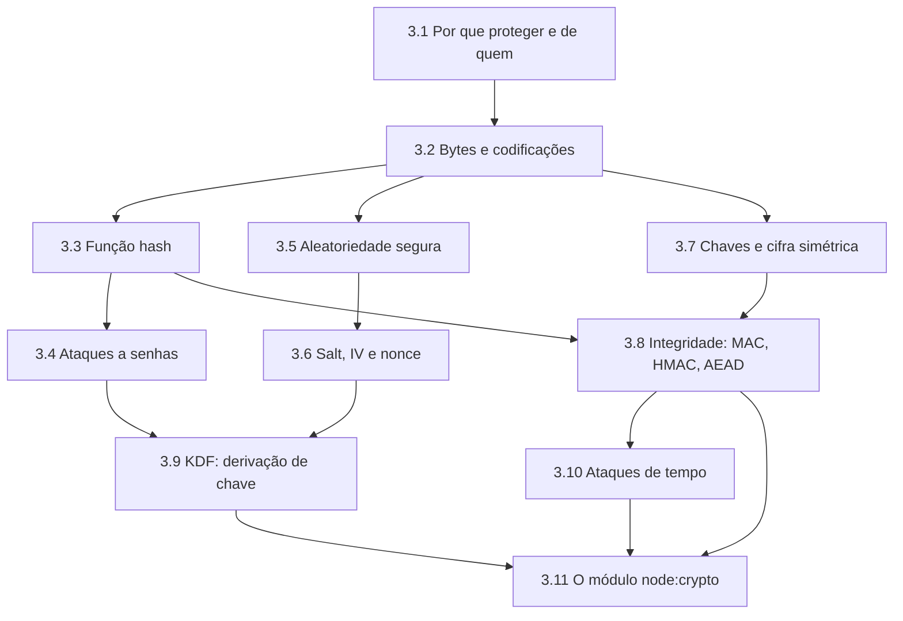

# Estudo: node:crypto (hash de senha, criptografia e HMAC)

> **Área:** Segurança de aplicações / Node.js · **Tipo de conhecimento:** tecnologia + conceitual · **Nível assumido:** você domina JavaScript/TypeScript, async/await e HTTP, mas **não** tem base em criptografia · **Tempo estimado:** 5 a 6 horas, em 4 sessões (a seção 3 sozinha pede uma sessão)

Assumi que você nunca estudou criptografia. A seção 3 ensina tudo do zero. Se algum bloco dela já for familiar, faça só a pergunta de recuperação correspondente (seção 8) e siga para o próximo.

**Arquivos do projeto que este estudo explica** (em `apps/web/src/infrastructure/`): `security/password.ts`, `security/crypto.ts` e `repositories/FileUserRepository.ts`.

---

## 0. Antes de ler (5 minutos)

No tablet, tente responder **sem consultar nada**. Errar é esperado; tentar primeiro deixa a leitura mais eficaz.

1. Se o banco de dados vazar, por que guardar a senha "criptografada" ainda é um problema? E guardar um hash comum?
2. Qual é a diferença entre **hash** e **criptografia**?
3. Para que serve um *salt*?
4. Por que `Math.random()` não serve para gerar uma chave ou um salt?

Deixe em branco o que não souber.

---

## 1. Como estudar este tema

| Técnica | Como aplicar neste tema | Onde |
|---|---|---|
| Prever antes de executar | Antes de rodar o script da seção 4.8, escreva o que cada `console.log` vai imprimir (tamanho do IV, o que acontece ao alterar 1 bit do texto cifrado). Rode e investigue cada diferença. | Tablet + terminal |
| Quebrar de propósito | Altere 1 byte do texto cifrado, reutilize um IV, remova o salt. Anote a mensagem de erro (ou a falta dela) de cada caso. | Terminal |
| Diagrama à mão | Desenhe dois fluxos, **cadastro** e **login**, marcando onde entram scrypt, salt, AES-GCM e HMAC e o que vai para o disco. No dia 3, redesenhe de memória e compare. | Tablet |
| Exemplo com lacunas | Faça os exercícios da seção 7 (código com `/* ??? */`) antes de olhar o gabarito. | Tablet |
| Página Feynman | Explique em uma página "hash x cifra x HMAC x base64" para um colega que nunca viu o assunto. Marque onde travou. | Tablet |


---

## 2. Visão geral

**Em uma frase:** `node:crypto` é o módulo nativo do Node.js com as ferramentas de criptografia (hash, HMAC, cifras, derivação de chaves, números aleatórios seguros), e no projeto ele guarda senhas sem guardá-las de fato e cifra o telefone em disco.

**Em um parágrafo:** não é uma biblioteca instalada: ele vem com o Node (`import { ... } from "node:crypto"`) e só funciona no **servidor**. No navegador, o equivalente é a Web Crypto API. Criptografia é fácil de usar errado, então a regra de ouro é usar ferramentas prontas e testadas (como estas) e entender para que serve cada uma, sem inventar algoritmo próprio.

**Quem faz o quê no projeto:**

| Necessidade | Ferramenta | Arquivo |
|---|---|---|
| Guardar a senha sem poder recuperá-la | scrypt (hash lento) + salt | `password.ts` |
| Comparar hashes sem vazar informação pelo tempo | `timingSafeEqual` | `password.ts` |
| Guardar o telefone podendo ler de volta | AES-256-GCM | `crypto.ts` |
| Derivar chaves diferentes de uma chave mestra | HKDF | `crypto.ts` |
| Buscar um usuário pelo telefone que está cifrado | HMAC-SHA256 (*blind index*) | `crypto.ts` |
| Gerar salt e IV imprevisíveis | `randomBytes` | `password.ts`, `crypto.ts` |

---

## 3. Fundamentos necessários

Esta seção existe para que **nenhum termo da seção 4 apareça sem ter sido explicado antes**. Leia na ordem: cada bloco usa só o que os anteriores ensinaram. Quando um termo reaparecer na seção 4, o bloco onde ele foi definido está indicado (ex.: "ver 3.4").



### 3.1 Por que proteger dados e de quem (modelo de ameaça)

**Criptografia não é "deixar tudo seguro"; é uma resposta a ameaças específicas.** Por isso, antes de qualquer ferramenta, pergunte: *o que eu quero proteger, e de quem?* Isso se chama **modelo de ameaça**.

No projeto, o servidor guarda um arquivo `users.json` com os usuários. As ameaças que escolhemos tratar:

| # | Ameaça (o que pode acontecer) | Exemplo concreto | Resposta no projeto |
|---|---|---|---|
| 1 | O arquivo vaza (backup esquecido, disco roubado, repositório público por engano) | Alguém abre o `users.json` | Telefone cifrado, senha só como hash |
| 2 | Alguém tenta descobrir as senhas a partir do arquivo vazado | Testa milhões de senhas por segundo no próprio computador | Hash **lento** com salt |
| 3 | Alguém altera o arquivo ou um token | Troca um valor para se passar por outro usuário | Autenticação (tag do AES-GCM, HMAC) |
| 4 | Alguém descobre segredos medindo o tempo de resposta | Mede quantos milissegundos o login leva | Comparação em tempo constante e hash falso |

**Dois estados do dado.** *Em trânsito* é o dado viajando pela rede (quem protege é o HTTPS). *Em repouso* é o dado guardado em disco ou banco (quem protege aqui é o `node:crypto`). Este documento trata do segundo.

**O que a criptografia não faz:** se o atacante controla o servidor em execução, ele tem acesso à memória e às variáveis de ambiente, ou seja, às chaves. Ver 4.9.

### 3.2 Bytes, Buffer e codificações (a "língua" da criptografia)

**Byte:** unidade de dado que guarda um número de 0 a 255. Todo dado (texto, imagem, senha) é, por baixo, uma sequência de bytes. **Criptografia só opera sobre bytes, nunca sobre "texto".**

**De texto para bytes:** o texto é convertido por uma tabela de caracteres, em geral **UTF-8**. Letras simples ocupam 1 byte; acentos ocupam mais. Exemplo: `"oi"` tem 2 bytes (`6f 69`) e `"olá"` tem **4 bytes** (`6f 6c c3 a1`), porque o "á" usa 2.

**`Buffer`:** objeto do Node.js que representa uma sequência de bytes, parecido com um array de números de 0 a 255, com métodos para converter em texto. `Buffer.from("oi")` cria os bytes de "oi". `Buffer.alloc(32)` cria 32 bytes zerados. `Buffer.concat([a, b])` junta buffers em um só. `buffer.length` é o número de bytes.

**Codificações (representar bytes como texto legível).** Bytes crus não são imprimíveis e não cabem bem em JSON, cookies ou URLs. Então os escrevemos com caracteres comuns:

| Codificação | Como funciona | Exemplo para os bytes de `"oi"` | Observação |
|---|---|---|---|
| **hex** | Cada byte vira 2 caracteres (0 a 9, a a f) | `6f69` | Dobra o tamanho |
| **base64** | A cada 3 bytes, 4 caracteres (A-Z, a-z, 0-9, `+`, `/`, e `=` de preenchimento) | `b2k=` | Cresce cerca de 33% |
| **base64url** | Igual ao base64, mas `+` vira `-`, `/` vira `_` e remove o `=` | os bytes `fb ff fe` dão `+//+` em base64 e `-__-` em base64url | Seguro em URLs e cookies |

> **Regra de ouro:** codificar **não protege nada**. Base64 é uma mudança de roupa, e qualquer pessoa desfaz sem chave. O projeto usa base64 e base64url só para guardar bytes dentro de JSON.

### 3.3 Função hash

**Definição.** Uma função hash recebe uma entrada de qualquer tamanho e devolve uma saída de **tamanho fixo**, chamada *hash*, *digest* ou "impressão digital" do dado. No SHA-256, a saída tem sempre 32 bytes (64 caracteres em hex), seja a entrada uma única letra ou um arquivo de vários gigabytes (como um vídeo). Entrada pequena ou gigante, a saída tem o mesmo tamanho.

**Propriedades que fazem dela útil (decore as quatro):**

1. **Determinística:** a mesma entrada dá sempre o mesmo hash.
2. **Mão única (resistência a pré-imagem):** dado o hash, é inviável descobrir a entrada. Não existe operação "desfazer".
3. **Efeito avalanche:** mudar 1 bit da entrada muda o hash inteiro.
4. **Resistência a colisão:** é inviável achar duas entradas diferentes com o mesmo hash.

**Veja o avalanche (SHA-256 real):**

```
sha256("oi") = 87f633634cc4b02f628685651f0a29b7bfa22a0bd841f725c6772dd00a58d489
sha256("Oi") = 4abbf38454d626d892e276a3f43c71c639681c94fb2154bdbaf22e30c27a2f0b
```

Uma letra maiúscula e os dois hashes não têm relação visível.

**Para que serve:** verificar integridade (o arquivo baixado é o original?), identificar dados, e ser peça de funções maiores (HMAC, derivação de chave).

**Para que NÃO serve sozinha:** guardar senha. O SHA-256 foi feito para ser **rápido**, e isso é um defeito para senhas (ver 3.4).

### 3.4 Como atacam senhas

Imagine que o `users.json` vazou. O atacante tem os hashes e quer as senhas. Ele não "desfaz" o hash (3.3), mas **chuta senhas, calcula o hash de cada uma e compara**:

- **Força bruta:** testa todas as combinações possíveis.
- **Ataque de dicionário:** testa primeiro senhas comuns (`123456`, `senha123`, nomes, datas), porque pessoas escolhem senhas previsíveis.
- **Tabela arco-íris (*rainbow table*):** uma tabela gigante, calculada **de antemão**, com hashes de milhões de senhas comuns. Achar o hash vira só uma consulta.
- **Ataque offline:** o atacante tem o arquivo e roda os chutes no próprio computador, **sem limite de tentativas e sem ninguém monitorando**. Contra isso, limitar tentativas no servidor não ajuda; só a **lentidão do hash** ajuda.

**Por que a velocidade é o problema.** Medi neste ambiente, num único processo comum: cerca de **1 milhão de SHA-256 por segundo**. Placas de vídeo fazem muito mais (da ordem de bilhões por segundo). Uma senha numérica de 8 dígitos tem 10^8 possibilidades: fica em minutos. O scrypt do projeto leva cerca de **0,5 s por tentativa e 128 MiB de memória**: são cerca de 2 tentativas por segundo contra cerca de 1 milhão do SHA-256 medido acima, ou seja, **centenas de milhares de vezes mais lento**, e ainda exige memória que placas de vídeo têm pouca por núcleo.

**Defesas (3.6 e 3.9):** *salt* contra tabelas pré-calculadas e *hash lento* contra força bruta.

### 3.5 Aleatoriedade segura

Salts, IVs e chaves precisam ser **imprevisíveis**. Existem dois tipos de gerador:

| Tipo | Exemplo em JS | Imprevisível? | Uso |
|---|---|---|---|
| **PRNG** (pseudoaleatório comum) | `Math.random()` | **Não.** Calculado por uma fórmula; quem observa algumas saídas pode prever as próximas | Sorteios, animações, jogos |
| **CSPRNG** (criptograficamente seguro) | `crypto.randomBytes(n)` | **Sim.** Usa a **entropia** do sistema operacional (ruído de hardware, eventos imprevisíveis) | Chaves, salts, IVs, tokens |

**Entropia** é a medida de quanta imprevisibilidade um valor tem. Uma senha de 4 dígitos tem pouca; 16 bytes de `randomBytes` têm 128 bits, algo que ninguém consegue adivinhar.

`randomBytes(16)` devolve um `Buffer` com 16 bytes aleatórios.

### 3.6 Salt, IV e nonce: aleatoriedade que **não** é segredo

São valores aleatórios gerados a cada operação para garantir que **entradas iguais produzam saídas diferentes**.

| Nome | Usado em | Problema que resolve |
|---|---|---|
| **Salt** | Hash de senha | Dois usuários com a mesma senha teriam o mesmo hash, e uma tabela arco-íris funcionaria. Com salt, cada hash é único e o atacante precisa atacar cada senha separadamente |
| **IV** (vetor de inicialização) | Cifra (AES) | Cifrar o mesmo texto duas vezes daria o mesmo resultado, revelando repetições |
| **Nonce** ("number used once") | Termo geral | Valor que **nunca pode se repetir** com a mesma chave. O IV do GCM é um nonce |

**Ponto-chave que confunde:** salt, IV e nonce **não são secretos**. Eles ficam guardados junto do resultado. O que é secreto é a **chave** (3.7). O papel deles é garantir unicidade, e não esconder.

### 3.7 Chaves e cifra simétrica

**Cifrar** é transformar um dado legível (*texto claro*, ou *plaintext*) em um dado ilegível (*texto cifrado*, ou *ciphertext*) usando uma **chave**; **decifrar** é a operação inversa, só possível com a chave certa. Diferente do hash (3.3), **a cifra é reversível**.

- **Chave:** sequência secreta de bytes. Quanto maior, mais difícil de adivinhar: uma chave de 32 bytes tem 256 bits.
- **Princípio de Kerckhoffs:** a segurança deve depender só do segredo da chave, e não de manter o algoritmo escondido. Os algoritmos (AES, SHA-256) são públicos e estudados por anos.
- **Simétrica:** a **mesma** chave cifra e decifra (AES). **Assimétrica:** um par de chaves, uma pública e outra privada (RSA). Neste projeto só o servidor cifra e decifra os próprios dados, então basta a simétrica.

**AES (Advanced Encryption Standard)** é o padrão mundial de cifra simétrica. É uma **cifra de bloco**: trabalha em blocos de 16 bytes. Como os dados quase nunca têm exatamente 16 bytes, existe o **modo de operação**, que define como encadear blocos:

| Modo | Característica |
|---|---|
| ECB | Cada bloco igual vira bloco cifrado igual: **vaza padrões. Nunca usar** |
| CBC | Encadeia blocos com IV, mas não detecta alteração |
| **GCM** | Cifra **e autentica**: detecta alteração (ver 3.8). É o que usamos |

`AES-256-GCM` = AES com chave de 256 bits (32 bytes) no modo GCM.

### 3.8 Integridade e autenticidade: MAC, HMAC e AEAD

Cifrar esconde o conteúdo, mas **não impede alteração**. Uma cifra sem autenticação pode ser adulterada: o atacante muda bytes do texto cifrado e o resultado decifra para algo diferente, sem ninguém perceber. Por isso existe a **autenticação**.

- **MAC (*Message Authentication Code*):** código calculado a partir de uma mensagem **e de uma chave secreta**. Só quem tem a chave consegue gerar ou conferir um MAC válido.
- **HMAC:** a forma padrão de construir um MAC usando uma função hash. **HMAC-SHA256(chave, mensagem)** devolve 32 bytes. É determinístico: mesma chave e mesma mensagem dão sempre a mesma saída, e chaves diferentes dão saídas totalmente diferentes:

```
HMAC-SHA256("chave",  "oi") = 43583751c9301b658c84fa618552b0af51bad237d4ef721bc0fdbde81dd726a2
HMAC-SHA256("outra",  "oi") = f08d211d7e78cf8ab4036711ae5b6ccfc47b7e88dc86d2890199a823dc2310b9
```

- **Hash x HMAC:** qualquer um calcula um hash; só quem tem a chave calcula um HMAC. Por isso o hash puro não prova **quem** gerou o dado.
- **Tag de autenticação:** o MAC embutido do GCM (16 bytes). Se qualquer bit do texto cifrado mudar, a tag não confere e a decifragem falha.
- **AEAD (*Authenticated Encryption with Associated Data*):** nome da categoria de cifras que **cifram e autenticam de uma vez**. O AES-GCM é AEAD.

### 3.9 Derivação de chave (KDF)

**KDF (*Key Derivation Function*)** é uma função que gera uma ou mais chaves a partir de outra informação. Há dois usos bem diferentes, e o projeto usa os dois:

| Uso | Entrada | Característica | Ferramenta |
|---|---|---|---|
| **Senha → chave/hash** | Senha humana (fraca, previsível) | **Lenta de propósito**, com custo ajustável | **scrypt** |
| **Chave forte → várias chaves** | Chave mestra já aleatória | **Rápida** | **HKDF** |

**Conceitos do scrypt:**
- **Fator de custo (*work factor*):** quanto trabalho cada hash exige. O parâmetro **N** controla isso: dobrar N dobra tempo e memória.
- **Memory-hard:** exige muita **memória**, e não só processamento. Isso encarece ataques com placas de vídeo e hardware dedicado, que têm pouca memória por núcleo.
- **r** (tamanho do bloco) e **p** (paralelismo) são os outros dois parâmetros.
- A memória usada por hash é cerca de `128 × N × r` bytes. Com N=2^17 e r=8: **128 MiB**.
- **Por que não SHA-256:** é rápido demais (3.4). O scrypt é a ferramenta feita para senhas.

**Conceito do HKDF:** a partir de uma **chave mestra** (a que vem da variável de ambiente), gera chaves independentes para finalidades diferentes, usando um rótulo (`info`) para cada uma. Assim a chave que cifra e a que calcula o HMAC são diferentes, mesmo nascendo da mesma origem.

### 3.10 Ataques de tempo (*timing attacks*)

Mesmo sem ler o segredo, um atacante pode **medir quanto tempo o servidor leva para responder** e deduzir informação. Exemplo: o operador `===` compara texto da esquerda para a direita e **para no primeiro byte diferente**. Quanto mais bytes iniciais coincidem, mais demora. Medindo o tempo de muitos chutes, o atacante descobre o valor byte a byte.

**Defesa:** comparação em **tempo constante**: a função leva o mesmo tempo, não importa onde estejam as diferenças. No Node, `timingSafeEqual`.

Outro vazamento por tempo: se o login responde rápido quando o telefone não existe e devagar quando existe (porque só nesse caso calcula o hash lento), o tempo revela **quais telefones têm conta** (*enumeração de usuários*). Defesa: calcular um hash falso para igualar o tempo (4.4).

### 3.11 O módulo `node:crypto` e outros pré-requisitos de Node

- **`node:crypto`** é um módulo **nativo** do Node.js, ou seja, já vem instalado. Importa-se com `import { randomBytes } from "node:crypto"`. O prefixo `node:` indica que é do próprio Node. **Só funciona no servidor.** No navegador, a API equivalente é a *Web Crypto API*.
- **Variável de ambiente:** valor de configuração definido **fora do código**, lido com `process.env.NOME`. Chaves e segredos ficam aqui para não ir ao Git. No projeto: `DATA_ENCRYPTION_KEY`, uma chave de 32 bytes escrita em base64.
- **Funções síncronas x callback x Promise:** algumas funções do `crypto` (como `scrypt`) são assíncronas com *callback* ("me avise quando terminar"). O projeto as embrulha em uma **Promise** para poder usar `await`. Assim o servidor não trava durante os ~0,5 s do hash.
- **`ArrayBuffer`:** outro tipo de bloco de bytes do JavaScript. `hkdfSync` devolve um `ArrayBuffer`, que convertemos em `Buffer` com `Buffer.from(...)`.

### 3.12 Mapa: conceito → onde aparece no projeto

| Conceito (bloco) | Onde está no código |
|---|---|
| Hash lento, salt (3.3, 3.4, 3.6, 3.9) | `password.ts` (scrypt) |
| CSPRNG (3.5) | `randomBytes` em `password.ts` e `crypto.ts` |
| Cifra autenticada (3.7, 3.8) | `encrypt` e `decrypt` em `crypto.ts` (AES-256-GCM) |
| HKDF (3.9) | derivação das chaves em `crypto.ts` |
| HMAC (3.8) | `blindIndex` em `crypto.ts` |
| Tempo constante (3.10) | `timingSafeEqual` e hash falso em `password.ts` |
| Variáveis de ambiente (3.11) | `DATA_ENCRYPTION_KEY` |

---

## 4. O conceito em profundidade

### 4.1 Qual ferramenta resolve qual problema

> **Antes de ler:** hash (3.3), cifra (3.7), HMAC (3.8), codificação (3.2), reversível x mão única.

| Pergunta | Ferramenta | Reversível? | Usa chave secreta? |
|---|---|---|---|
| Esse dado foi alterado? Quem o gerou? | HMAC | Não | Sim |
| Preciso guardar uma senha sem poder lê-la de volta? | Hash lento (scrypt) | Não | Não (usa salt) |
| Preciso guardar um dado e lê-lo depois (telefone)? | Cifra (AES-GCM) | Sim | Sim |
| Só quero mudar a representação do dado? | base64 / hex | Sim | **Não: não é segurança** |

### 4.2 Hash de senha com scrypt (`password.ts`)

> **Antes de ler:** salt (3.6), KDF e fator de custo (3.9), ataques a senha (3.4), `Buffer` e base64 (3.2), Promise (3.11).

**Definição.** O scrypt é uma função de derivação de chave projetada para ser **lenta e gastar memória**. Isso encarece tentar adivinhar senhas em massa caso o banco vaze.

**Por que não SHA-256 puro?** O SHA-256 é rápido de propósito. Uma placa de vídeo testa bilhões por segundo. O scrypt força cada tentativa a gastar tempo e memória.

**Parâmetros:**

| Parâmetro | O que controla | No projeto |
|---|---|---|
| `N` | Custo de CPU e memória (potência de 2) | 2^17 = 131072 |
| `r` | Tamanho do bloco | 8 |
| `p` | Paralelismo | 1 |
| salt | Aleatório por senha | 16 bytes |

A memória usada por hash é `128 × N × r` bytes. Com N=2^17 e r=8 são **128 MiB** por verificação. Essa configuração é o mínimo recomendado pela OWASP para scrypt quando o Argon2id não está disponível. Os padrões do Node são mais fracos (N=2^14 e limite de 32 MiB), por isso o código passa `N`, `r`, `p` e `maxmem` explicitamente.

**Formato guardado:** `scrypt$131072$8$1$<salt>$<hash>`. Os parâmetros ficam **dentro** do hash, então dá para aumentar o custo no futuro sem invalidar quem já se cadastrou.

```ts
export async function hashPassword(password: string): Promise<string> {
    const salt = randomBytes(16)                                   // 1. salt único por senha
    const key = await derive(password, salt, N, r, p)              // 2. deriva (~0,5 s: é de propósito)
    return ["scrypt", N, r, p, salt.toString("base64"), key.toString("base64")].join("$")
}

export async function verifyPassword(password: string, stored: string) {
    const [scheme, n, r, p, saltB64, hashB64] = stored.split("$")  // 3. lê parâmetros e salt guardados
    const expected = Buffer.from(hashB64, "base64")
    const actual = await derive(password, Buffer.from(saltB64, "base64"), Number(n), Number(r), Number(p)) // 4. recalcula
    return actual.length === expected.length && timingSafeEqual(actual, expected)  // 5. compara em tempo constante
}
```

> Versão simplificada para estudo. O arquivo real também valida o formato do hash e envolve o `scrypt` (que usa callback) em uma `Promise`.

**Repare:** o login **nunca** decifra nada. Ele recalcula o hash com o mesmo salt e compara. Por isso uma senha esquecida não pode ser "recuperada", apenas redefinida.

### 4.3 `timingSafeEqual`: comparação em tempo constante

> **Antes de ler:** ataque de tempo (3.10).

Comparar com `===` pode parar no primeiro byte diferente. Quem mede o tempo de resposta descobre quantos bytes iniciais batem. `timingSafeEqual` leva o mesmo tempo independente de onde está a diferença. Ele **lança erro se os tamanhos forem diferentes** (`ERR_CRYPTO_TIMING_SAFE_EQUAL_LENGTH`), por isso o código confere `length` antes.

### 4.4 O hash falso (`getDummyHash`)

> **Antes de ler:** enumeração de usuários e ataque de tempo (3.10).

Se o telefone do login não existe, o servidor ainda assim executa uma verificação contra um hash falso. Sem isso, "usuário inexistente" responderia mais rápido que "senha errada" e o tempo revelaria quais telefones têm conta. No teste, as duas respostas ficaram com o mesmo tempo (cerca de 0,15 s na época, com N menor).

### 4.5 AES-256-GCM (`crypto.ts`)

> **Antes de ler:** chave, AES e modo GCM (3.7), IV (3.6), tag e AEAD (3.8), base64url (3.2).

**Definição.** AES é uma cifra simétrica. **GCM** é um modo de operação que, além de cifrar (confidencialidade), **autentica** o conteúdo (integridade): se alguém alterar o texto cifrado, a decifragem falha. Esse tipo se chama AEAD.

**Peças:**

| Peça | Tamanho | Papel |
|---|---|---|
| Chave | 32 bytes (256 bits) | Segredo, vem do ambiente |
| IV (nonce) | 12 bytes | Aleatório, **único a cada cifragem** com a mesma chave. Não é secreto |
| Tag de autenticação | 16 bytes | Prova que o conteúdo não foi alterado |

**Formato guardado:** `v1.<iv>.<tag>.<cifrado>` (cada parte em base64url). O prefixo `v1` permite mudar o formato no futuro.

```ts
export function encrypt(plainText: string): string {
    const iv = randomBytes(12)                                          // 1. IV novo a cada chamada
    const cipher = createCipheriv("aes-256-gcm", encryptionKey, iv)     // 2. cifra com a chave derivada
    const data = Buffer.concat([cipher.update(plainText, "utf8"), cipher.final()])
    const tag = cipher.getAuthTag()                                     // 3. tag só existe depois do final()
    return ["v1", iv.toString("base64url"), tag.toString("base64url"), data.toString("base64url")].join(".")
}

export function decrypt(payload: string): string {
    const [version, iv, tag, data] = payload.split(".")
    const decipher = createDecipheriv("aes-256-gcm", encryptionKey, Buffer.from(iv, "base64url"))
    decipher.setAuthTag(Buffer.from(tag, "base64url"))                  // 4. informa a tag ANTES do final()
    return Buffer.concat([decipher.update(Buffer.from(data, "base64url")), decipher.final()]).toString("utf8")
    //                                                                    ^ final() lança erro se a tag não bater
}
```

### 4.6 HKDF: várias chaves a partir de uma

> **Antes de ler:** KDF rápida e chave mestra (3.9), variável de ambiente (3.11), `ArrayBuffer` (3.11).

`hkdfSync("sha256", chaveMestra, salt, info, 32)` deriva uma chave de 32 bytes. O parâmetro `info` é um rótulo de finalidade (`"data-encryption"`, `"blind-index"`). *Por quê:* usar a mesma chave para cifrar e para HMAC mistura papéis, e o vazamento de um uso comprometeria o outro. Com HKDF, **uma única variável de ambiente** (`DATA_ENCRYPTION_KEY`) gera chaves independentes. A função devolve um `ArrayBuffer`, então o código faz `Buffer.from(...)`.

### 4.7 HMAC e o *blind index*

> **Antes de ler:** HMAC (3.8), determinismo (3.3), IV aleatório (3.6).

**HMAC-SHA256(chave, mensagem)** gera 32 bytes (64 caracteres hex). É determinístico: mesma chave e mesma mensagem dão sempre a mesma saída.

**O problema que ele resolve:** como o AES-GCM usa IV aleatório, o mesmo telefone cifrado duas vezes gera textos diferentes, então **não dá para buscar** `WHERE phoneEncrypted = ...`. A solução é guardar, ao lado do telefone cifrado, um **índice cego** (`phoneIndex = HMAC(telefone)`). No login, calculamos o HMAC do telefone digitado e procuramos por ele.

```ts
const index = blindIndex(phone)                                  // HMAC do telefone digitado
const stored = users.find((u) => u.phoneIndex === index)         // acha sem nunca guardar o telefone em claro
const phone = decrypt(stored.phoneEncrypted)                     // só depois decifra para usar
```

**Custo da técnica:** o índice revela **igualdade** (dois registros com o mesmo telefone teriam o mesmo índice; aqui o telefone é único) e depende do sigilo da chave. Telefones têm pouca variedade (da ordem de 10^10 combinações), então, **se a chave vazar**, um atacante consegue testar todos os candidatos.

### 4.8 Exemplo trabalhado (rode no terminal)

> **Antes de ler:** `randomBytes` (3.5), `Buffer` (3.2).

Crie `teste.mjs` e **digite** (não copie e cole) cada passo, prevendo antes a saída:

```js
import { createCipheriv, createDecipheriv, randomBytes, hkdfSync } from "node:crypto"

const master = Buffer.alloc(32, 7)                                   // chave mestra de estudo
const key = Buffer.from(hkdfSync("sha256", master, Buffer.alloc(0), "data-encryption", 32))

const iv = randomBytes(12)
const c = createCipheriv("aes-256-gcm", key, iv)
const data = Buffer.concat([c.update("11987654321", "utf8"), c.final()])
const tag = c.getAuthTag()
console.log("iv:", iv.length, "| tag:", tag.length, "| cifrado:", data.length)

const d = createDecipheriv("aes-256-gcm", key, iv); d.setAuthTag(tag)
console.log("decifrado:", Buffer.concat([d.update(data), d.final()]).toString())

const bad = Buffer.from(data); bad[0] ^= 1                           // inverte 1 bit
try { const d2 = createDecipheriv("aes-256-gcm", key, iv); d2.setAuthTag(tag); d2.update(bad); d2.final() }
catch (e) { console.log("adulterado ->", e.message) }
```

**Saída real (Node 22):**
```
iv: 12 | tag: 16 | cifrado: 11
decifrado: 11987654321
adulterado -> Unsupported state or unable to authenticate data
```

**Raciocínio de cada passo:**
1. O cifrado tem **11 bytes**, o mesmo tamanho do texto "11987654321": o GCM não aumenta o conteúdo, a autenticação fica na tag separada.
2. Com o IV, a chave e a tag corretos, o texto volta idêntico.
3. Ao inverter **um único bit**, a tag deixa de bater e `final()` lança erro. É isso que impede que alguém altere dados no arquivo sem ser notado.
4. Repita a cifragem com outro `randomBytes(12)`: o resultado muda por completo, mesmo com o mesmo texto. É por isso que precisamos do blind index.

### 4.9 Contraexemplos e limites

> **Antes de ler:** modelo de ameaça e dado em repouso (3.1), entropia (3.5).

- **Criptografia em repouso não protege de um servidor invadido.** Ela protege contra vazamento do arquivo ou de um backup. Se o atacante controla o processo, a chave (que está na variável de ambiente) está ao alcance dele.
- **Reutilizar o IV com a mesma chave no GCM é catastrófico:** permite relacionar textos e forjar tags. O IV aleatório de 96 bits evita isso na prática para este volume.
- **Não há rotação de chave.** O prefixo `v1` deixa o caminho aberto, mas trocar `DATA_ENCRYPTION_KEY` hoje **invalida todos os telefones guardados**.
- **O scrypt custa 128 MiB por verificação.** Muitos logins simultâneos consomem memória (risco de negação de serviço). O limite de tentativas por IP + telefone ajuda, mas não cobre um atacante que varie IP e telefone.
- **O scrypt não é criptografia:** não há como "decifrar" o hash. Serve só para verificar.

### 4.10 Erros e equívocos comuns

- Usar SHA-256 (ou MD5) puro para senha.
- "Criptografar" a senha em vez de gerar um hash (cifra é reversível: quem tem a chave lê todas as senhas).
- Gerar salt ou IV com `Math.random()`.
- Deixar a chave no código-fonte ou no Git.
- Reutilizar o IV.
- Comparar hashes com `===`.
- Achar que base64 "esconde" um dado.
- Registrar senhas ou chaves em log.

---

## 5. Conexões e confusões

| Termo | Para que serve | Usa chave? | Reversível? | Não confundir com |
|---|---|---|---|---|
| **Hash** (SHA-256) | Impressão digital de um dado | Não | Não | Cifra (hash não tem volta) |
| **HMAC** | Hash + chave secreta: autenticidade e integridade | Sim | Não | Hash simples (qualquer um calcula) |
| **Cifra** (AES-GCM) | Esconder um dado e recuperá-lo | Sim | Sim | Hash |
| **Codificação** (base64, hex) | Representar bytes como texto | Não | Sim | Cifra (não protege nada) |
| **Assinatura digital** | Autenticidade com chave pública/privada | Par de chaves | Não | HMAC (aqui a chave é compartilhada) |

**Algoritmos de hash de senha:**

| Algoritmo | Característica | Observação |
|---|---|---|
| Argon2id | Memory-hard, moderno | Primeira escolha da OWASP |
| **scrypt** | Memory-hard, já vem no Node | **Usado no projeto**: alternativa recomendada quando o Argon2id não está disponível |
| bcrypt | CPU-hard, limite de 72 bytes de senha | Aceitável em sistemas legados |
| PBKDF2 | Só CPU, precisa de muitas iterações | Para ambientes que exigem FIPS |

**Relação com os outros estudos:** o HMAC é a base do JWT assinado (`estudo-jose-jwt.md`), e este documento roda dentro das rotas de API do Next (`estudo-nextjs-seguranca.md`).

---

## 6. Glossário

- **AEAD:** cifra que protege confidencialidade e integridade juntas.
- **Blind index:** HMAC do valor, guardado para permitir busca sem guardar o valor.
- **Buffer:** array de bytes do Node.
- **CSPRNG:** gerador de números aleatórios seguro para criptografia (`randomBytes`).
- **GCM:** modo de operação do AES que autentica o conteúdo.
- **HKDF:** KDF rápida usada para derivar várias chaves de uma chave mestra.
- **HMAC:** hash com chave secreta.
- **IV / nonce:** valor aleatório e não secreto, único por cifragem.
- **KDF:** função de derivação de chave.
- **Memory-hard:** que exige muita memória, para encarecer ataques em hardware especializado.
- **Salt:** valor aleatório e não secreto, único por senha.
- **Tag de autenticação:** 16 bytes que provam que o texto cifrado não foi alterado.
- **Timing attack:** descobrir um segredo medindo o tempo de resposta.
- **Entropia:** medida de imprevisibilidade de um valor.
- **Modelo de ameaça:** definição do que se protege e de quem.
- **PRNG x CSPRNG:** gerador previsível x gerador seguro para criptografia.
- **Rainbow table:** tabela pré-calculada de hashes de senhas comuns.
- **Texto claro / texto cifrado (*plaintext / ciphertext*):** dado legível / dado cifrado.
- **Work factor (fator de custo):** quanto trabalho cada hash exige.
- **OWASP:** organização que publica guias de segurança de referência.
- **Negação de serviço (DoS):** esgotar os recursos do servidor (memória, CPU) para derrubá-lo.
- **MiB:** mebibyte, 1024 × 1024 bytes.
- **Argon2id, bcrypt, PBKDF2:** outros algoritmos de hash de senha (seção 5).
- **FIPS:** padrão de certificação do governo dos EUA para módulos criptográficos.

---

## 7. Autoteste

Responda no tablet, **sem olhar** o documento. Gabarito logo abaixo.

1. Com suas palavras: por que o login nunca "decifra" a senha?
2. Por que o scrypt é **lento de propósito**, e por que isso é uma vantagem?
3. O que acontece se dois usuários escolherem a mesma senha? Por quê?
4. Para que serve a *tag* no AES-GCM? O que acontece se um byte do cifrado for alterado?
5. Por que não conseguimos buscar um usuário diretamente pelo telefone cifrado? Como o projeto resolve?
6. Detecte o erro: `const salt = Buffer.from(Math.random().toString())`. Qual o problema?
7. Um colega diz: "guardei a senha em base64, então está segura". Responda.
8. A chave `DATA_ENCRYPTION_KEY` foi trocada por outra e o servidor reiniciado. O que acontece com os usuários já cadastrados? Por quê?

**Exercício com lacunas A.** Complete `decrypt`:

```ts
export function decrypt(payload: string): string {
    const [version, iv, tag, data] = payload.split(".")
    const decipher = createDecipheriv("aes-256-gcm", encryptionKey, /* ??? 1 */)
    decipher.setAuthTag(/* ??? 2 */)
    return Buffer.concat([decipher.update(/* ??? 3 */), /* ??? 4 */]).toString("utf8")
}
```

**Exercício com lacunas B.** Complete a verificação de senha:

```ts
const actual = await derive(password, /* ??? 1 */, Number(n), Number(r), Number(p))
return /* ??? 2 */ && timingSafeEqual(actual, expected)
```

### Gabarito

1. Porque o que está guardado é um hash, que não tem volta. O login recalcula o hash da senha digitada com o mesmo salt e parâmetros e compara com o guardado.
2. Quem rouba o banco precisa testar senhas uma a uma. Se cada tentativa custa ~0,5 s e 128 MiB, testar bilhões fica inviável. Para o usuário legítimo, um único login lento é imperceptível.
3. Os hashes serão diferentes, porque cada um usa um salt aleatório próprio. Isso impede tabelas pré-calculadas e esconde que duas pessoas usam a mesma senha.
4. A tag prova a integridade. Se um byte for alterado, `final()` lança erro (`Unsupported state or unable to authenticate data`) e nada é devolvido.
5. O IV aleatório faz o mesmo telefone gerar cifrados diferentes a cada vez. O projeto guarda também um HMAC do telefone (*blind index*), que é determinístico, e busca por ele.
6. `Math.random()` é previsível, e o salt é gerado como texto, com pouquíssima aleatoriedade. Deve ser `randomBytes(16)`.
7. Base64 é só uma codificação, qualquer um decodifica sem chave. Senha deve ser guardada como hash lento com salt (scrypt, Argon2id).
8. Todos os telefones guardados ficam ilegíveis: `decrypt` lança erro, porque a tag não confere com a nova chave. Não há rotação de chave implementada, então a chave não pode ser trocada sem migrar os dados.

**Lacunas A:** 1) `Buffer.from(iv, "base64url")` 2) `Buffer.from(tag, "base64url")` 3) `Buffer.from(data, "base64url")` 4) `decipher.final()`. É o `final()` que verifica a tag e lança erro se algo foi alterado.

**Lacunas B:** 1) `Buffer.from(saltB64, "base64")` (o salt **guardado** junto do hash, e não um novo) 2) `actual.length === expected.length` (porque `timingSafeEqual` lança erro se os tamanhos forem diferentes).

### Autoteste dos fundamentos (seção 3)

Responda sem consultar a seção 3.

1. Por que `"olá"` tem 4 bytes e `"oi"` tem 2?
2. Base64 protege um dado? Explique.
3. Cite duas propriedades de uma função hash e uma razão pela qual ela, sozinha, não serve para senha.
4. Qual a diferença entre `Math.random()` e `randomBytes`, e por que importa para um salt?
5. Salt e IV são secretos? Então qual é o segredo?
6. Por que cifrar sem autenticar é perigoso?
7. Qual a diferença entre hash e HMAC?
8. Por que `===` é problema ao comparar hashes?

**Gabarito dos fundamentos**

1. O "á" ocupa 2 bytes em UTF-8; letras sem acento ocupam 1.
2. Não. É só uma codificação reversível sem chave.
3. Determinística e mão única (também avalanche e resistência a colisão). Sozinha é rápida demais, e o atacante testa bilhões de senhas por segundo.
4. `Math.random()` é previsível; `randomBytes` usa entropia do sistema. Um salt previsível permite ataques pré-calculados.
5. Não. O segredo é a chave. Salt e IV só garantem unicidade.
6. O atacante pode alterar o texto cifrado e o resultado decifra para algo diferente sem ninguém perceber.
7. Qualquer um calcula um hash; só quem tem a chave calcula um HMAC.
8. Para no primeiro byte diferente, e o tempo de resposta revela informação.

---

## 8. Revisão seção por seção

A revisão é feita no próprio documento, seção por seção.

Método em cada revisão, **uma seção por vez**:

1. Leia só o título da seção e **cubra o texto** (com a mão ou com uma folha).
2. Responda a pergunta de recuperação da tabela abaixo **por escrito, no tablet**, sem olhar.
3. Descubra o texto e compare. Marque ✔ (acertei) ou ✗ (errei ou esqueci) na margem.
4. Reescreva **só a parte errada** com suas palavras. Seções ✗ voltam primeiro na próxima revisão.

| Seção | Pergunta de recuperação (responda cobrindo o texto) |
|---|---|
| 3 (todas) | Explique com suas palavras 5 termos da seção 3 que você teria dificuldade de explicar a um colega (escolha os que mais errou). |
| 2 e 4.1 | Qual ferramenta resolve cada problema (senha, telefone, busca por telefone, aleatoriedade)? Quais são reversíveis? |
| 4.2 | Escreva os 5 passos de `hashPassword`/`verifyPassword` e diga por que o scrypt é lento de propósito. |
| 4.3 e 4.4 | Por que `timingSafeEqual`? Por que o login roda um hash falso quando o telefone não existe? |
| 4.5 | Desenhe o formato `v1.iv.tag.cifrado`. O que cada parte faz e o que acontece se um bit mudar? |
| 4.6 e 4.7 | Por que HKDF com `info` diferente? Como o blind index permite buscar sem guardar o telefone? |
| 4.9 | Liste 4 limites desta solução (chave, rotação, memória, servidor invadido). |
| 5 | Hash x HMAC x cifra x base64: diga o que cada um faz e se usa chave. |

> Dica: se quiser anotar com a caneta direto no documento, exporte para PDF e use um app de anotação no tablet.

---

## 9. Plano de revisão

Todas as revisões seguem o método da seção 8. O foco muda a cada data:

| Quando | Seções a revisar | O que fazer além do método |
|---|---|---|
| Dia 1 | Todas, na ordem | Rode o script da 4.8 e refaça o diagrama dos fluxos de cadastro e login. |
| Dia 3 | Só as marcadas ✗ + 4.2 e 4.5 | Redesenhe os fluxos de memória. Refaça as lacunas da seção 7. |
| 1 semana | Todas | Faça o autoteste da seção 7 inteiro e escreva a página Feynman (hash x cifra x HMAC x base64). |
| 2 semanas | 4.2 a 4.7 | Abra `password.ts` e `crypto.ts` sem o estudo e explique cada linha em voz alta. |
| 1 mês | Marcadas ✗ + 4.9 | Reescreva `hashPassword` e `encrypt` do zero, consultando só a documentação oficial. |

Se uma seção sair ✗ duas vezes seguidas, releia-a inteira antes de seguir. Releitura passiva do documento todo não conta como revisão.

---

## 10. Para aprofundar

- Documentação oficial do Node.js, módulo `crypto` (nodejs.org/api/crypto.html): `scrypt`, `createCipheriv`, `hkdfSync`, `timingSafeEqual`.
- OWASP, *Password Storage Cheat Sheet* (cheatsheetseries.owasp.org): ordem de preferência e parâmetros recomendados.
- RFC 7914 (scrypt), RFC 5869 (HKDF) e RFC 2104 (HMAC).
- NIST SP 800-38D: especificação do modo GCM.
- Jean-Philippe Aumasson, *Serious Cryptography*: livro introdutório e prático.
