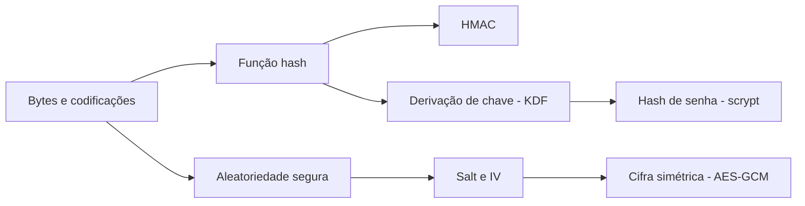

# Estudo: node:crypto (hash de senha, criptografia e HMAC)

> **Área:** Segurança de aplicações / Node.js · **Tipo de conhecimento:** tecnologia + conceitual · **Nível assumido:** você domina JavaScript/TypeScript, async/await e HTTP, mas **não** tem base em criptografia · **Tempo estimado:** 3 a 4 horas, em 3 sessões

Assumi que você nunca estudou criptografia. Se já souber o que é um hash, pule a seção 3 e comece na 4.

**Arquivos do projeto que este estudo explica** (em `apps/web/src/infrastructure/`): `security/password.ts`, `security/crypto.ts` e `repositories/FileUserRepository.ts`.

---

## 0. Antes de ler (5 minutos)

No tablet, tente responder **sem consultar nada**. Errar é esperado; tentar primeiro deixa a leitura mais eficaz.

1. Se o banco de dados vazar, por que guardar a senha "criptografada" ainda é um problema? E guardar um hash comum?
2. Qual é a diferença entre **hash** e **criptografia**?
3. Para que serve um *salt*?
4. Por que `Math.random()` não serve para gerar uma chave ou um salt?

Deixe em branco o que não souber.

---

## 1. Como estudar este tema

| Técnica | Como aplicar neste tema | Onde |
|---|---|---|
| Prever antes de executar | Antes de rodar o script da seção 4.8, escreva o que cada `console.log` vai imprimir (tamanho do IV, o que acontece ao alterar 1 bit do texto cifrado). Rode e investigue cada diferença. | Tablet + terminal |
| Quebrar de propósito | Altere 1 byte do texto cifrado, reutilize um IV, remova o salt. Anote a mensagem de erro (ou a falta dela) de cada caso. | Terminal |
| Diagrama à mão | Desenhe dois fluxos, **cadastro** e **login**, marcando onde entram scrypt, salt, AES-GCM e HMAC e o que vai para o disco. No dia 3, redesenhe de memória e compare. | Tablet |
| Exemplo com lacunas | Faça os exercícios da seção 7 (código com `/* ??? */`) antes de olhar o gabarito. | Tablet |
| Página Feynman | Explique em uma página "hash x cifra x HMAC x base64" para um colega que nunca viu o assunto. Marque onde travou. | Tablet |


---

## 2. Visão geral

**Em uma frase:** `node:crypto` é o módulo nativo do Node.js com as ferramentas de criptografia (hash, HMAC, cifras, derivação de chaves, números aleatórios seguros), e no projeto ele guarda senhas sem guardá-las de fato e cifra o telefone em disco.

**Em um parágrafo:** não é uma biblioteca instalada: ele vem com o Node (`import { ... } from "node:crypto"`) e só funciona no **servidor**. No navegador, o equivalente é a Web Crypto API. Criptografia é fácil de usar errado, então a regra de ouro é usar ferramentas prontas e testadas (como estas) e entender para que serve cada uma, sem inventar algoritmo próprio.

**Quem faz o quê no projeto:**

| Necessidade | Ferramenta | Arquivo |
|---|---|---|
| Guardar a senha sem poder recuperá-la | scrypt (hash lento) + salt | `password.ts` |
| Comparar hashes sem vazar informação pelo tempo | `timingSafeEqual` | `password.ts` |
| Guardar o telefone podendo ler de volta | AES-256-GCM | `crypto.ts` |
| Derivar chaves diferentes de uma chave mestra | HKDF | `crypto.ts` |
| Buscar um usuário pelo telefone que está cifrado | HMAC-SHA256 (*blind index*) | `crypto.ts` |
| Gerar salt e IV imprevisíveis | `randomBytes` | `password.ts`, `crypto.ts` |

---

## 3. Fundamentos necessários



**3.1 Bytes, Buffer e codificações.** Um `Buffer` é um array de bytes. `hex`, `base64` e `base64url` são **maneiras de escrever bytes como texto**, e não oferecem segurança alguma. *Por que precisa:* tudo em criptografia é bytes, e nós guardamos o resultado como texto no JSON. *Mini-exemplo:* `Buffer.from("oi").toString("hex")` dá `"6f69"`, e com `"base64"` dá `"b2k="`.

**3.2 Função hash.** Recebe qualquer entrada e devolve uma saída de tamanho fixo (SHA-256: sempre 32 bytes, 64 caracteres em hex). É determinística (mesma entrada, mesma saída), de mão única (não dá para voltar) e mudar 1 bit da entrada muda a saída inteira (efeito avalanche). *Por que precisa:* é a base do HMAC e das funções de senha.

**3.3 Aleatoriedade criptográfica.** `randomBytes(n)` usa a fonte de aleatoriedade do sistema operacional, imprevisível por projeto. `Math.random()` é um gerador estatístico, e quem observa algumas saídas consegue prever as próximas. *Por que precisa:* salt, IV e chaves só funcionam se ninguém conseguir adivinhá-los.

**3.4 Criptografia simétrica x assimétrica.** Na simétrica, **a mesma chave** cifra e decifra (AES). Na assimétrica há um par de chaves (RSA, por exemplo). *Por que precisa:* tudo aqui é simétrico, porque o servidor cifra e decifra os próprios dados.

**3.5 Salt e IV (nonce).** São valores **aleatórios e não secretos** que fazem entradas iguais produzirem saídas diferentes. O *salt* é usado em hash de senha, o *IV* em cifras. Vão guardados junto do resultado. *Por que precisa:* sem eles, dois usuários com a mesma senha teriam o mesmo hash, e atacantes usariam tabelas prontas.

**3.6 Derivação de chave (KDF).** Função que transforma uma entrada (uma senha ou uma chave) em chaves com propriedades úteis. Algumas são **lentas de propósito** (scrypt, para dificultar chutes de senha), outras são rápidas e servem para separar chaves (HKDF). *Por que precisa:* o projeto usa as duas.

---

## 4. O conceito em profundidade

### 4.1 Qual ferramenta resolve qual problema

| Pergunta | Ferramenta | Reversível? | Usa chave secreta? |
|---|---|---|---|
| Esse dado foi alterado? Quem o gerou? | HMAC | Não | Sim |
| Preciso guardar uma senha sem poder lê-la de volta? | Hash lento (scrypt) | Não | Não (usa salt) |
| Preciso guardar um dado e lê-lo depois (telefone)? | Cifra (AES-GCM) | Sim | Sim |
| Só quero mudar a representação do dado? | base64 / hex | Sim | **Não: não é segurança** |

### 4.2 Hash de senha com scrypt (`password.ts`)

**Definição.** O scrypt é uma função de derivação de chave projetada para ser **lenta e gastar memória**. Isso encarece tentar adivinhar senhas em massa caso o banco vaze.

**Por que não SHA-256 puro?** O SHA-256 é rápido de propósito. Uma placa de vídeo testa bilhões por segundo. O scrypt força cada tentativa a gastar tempo e memória.

**Parâmetros:**

| Parâmetro | O que controla | No projeto |
|---|---|---|
| `N` | Custo de CPU e memória (potência de 2) | 2^17 = 131072 |
| `r` | Tamanho do bloco | 8 |
| `p` | Paralelismo | 1 |
| salt | Aleatório por senha | 16 bytes |

A memória usada por hash é `128 × N × r` bytes. Com N=2^17 e r=8 são **128 MiB** por verificação. Essa configuração é o mínimo recomendado pela OWASP para scrypt quando o Argon2id não está disponível. Os padrões do Node são mais fracos (N=2^14 e limite de 32 MiB), por isso o código passa `N`, `r`, `p` e `maxmem` explicitamente.

**Formato guardado:** `scrypt$131072$8$1$<salt>$<hash>`. Os parâmetros ficam **dentro** do hash, então dá para aumentar o custo no futuro sem invalidar quem já se cadastrou.

```ts
export async function hashPassword(password: string): Promise<string> {
    const salt = randomBytes(16)                                   // 1. salt único por senha
    const key = await derive(password, salt, N, r, p)              // 2. deriva (~0,5 s: é de propósito)
    return ["scrypt", N, r, p, salt.toString("base64"), key.toString("base64")].join("$")
}

export async function verifyPassword(password: string, stored: string) {
    const [scheme, n, r, p, saltB64, hashB64] = stored.split("$")  // 3. lê parâmetros e salt guardados
    const expected = Buffer.from(hashB64, "base64")
    const actual = await derive(password, Buffer.from(saltB64, "base64"), Number(n), Number(r), Number(p)) // 4. recalcula
    return actual.length === expected.length && timingSafeEqual(actual, expected)  // 5. compara em tempo constante
}
```

> Versão simplificada para estudo. O arquivo real também valida o formato do hash e envolve o `scrypt` (que usa callback) em uma `Promise`.

**Repare:** o login **nunca** decifra nada. Ele recalcula o hash com o mesmo salt e compara. Por isso uma senha esquecida não pode ser "recuperada", apenas redefinida.

### 4.3 `timingSafeEqual`: comparação em tempo constante

Comparar com `===` pode parar no primeiro byte diferente. Quem mede o tempo de resposta descobre quantos bytes iniciais batem. `timingSafeEqual` leva o mesmo tempo independente de onde está a diferença. Ele **lança erro se os tamanhos forem diferentes** (`ERR_CRYPTO_TIMING_SAFE_EQUAL_LENGTH`), por isso o código confere `length` antes.

### 4.4 O hash falso (`getDummyHash`)

Se o telefone do login não existe, o servidor ainda assim executa uma verificação contra um hash falso. Sem isso, "usuário inexistente" responderia mais rápido que "senha errada" e o tempo revelaria quais telefones têm conta. No teste, as duas respostas ficaram com o mesmo tempo (cerca de 0,15 s na época, com N menor).

### 4.5 AES-256-GCM (`crypto.ts`)

**Definição.** AES é uma cifra simétrica. **GCM** é um modo de operação que, além de cifrar (confidencialidade), **autentica** o conteúdo (integridade): se alguém alterar o texto cifrado, a decifragem falha. Esse tipo se chama AEAD.

**Peças:**

| Peça | Tamanho | Papel |
|---|---|---|
| Chave | 32 bytes (256 bits) | Segredo, vem do ambiente |
| IV (nonce) | 12 bytes | Aleatório, **único a cada cifragem** com a mesma chave. Não é secreto |
| Tag de autenticação | 16 bytes | Prova que o conteúdo não foi alterado |

**Formato guardado:** `v1.<iv>.<tag>.<cifrado>` (cada parte em base64url). O prefixo `v1` permite mudar o formato no futuro.

```ts
export function encrypt(plainText: string): string {
    const iv = randomBytes(12)                                          // 1. IV novo a cada chamada
    const cipher = createCipheriv("aes-256-gcm", encryptionKey, iv)     // 2. cifra com a chave derivada
    const data = Buffer.concat([cipher.update(plainText, "utf8"), cipher.final()])
    const tag = cipher.getAuthTag()                                     // 3. tag só existe depois do final()
    return ["v1", iv.toString("base64url"), tag.toString("base64url"), data.toString("base64url")].join(".")
}

export function decrypt(payload: string): string {
    const [version, iv, tag, data] = payload.split(".")
    const decipher = createDecipheriv("aes-256-gcm", encryptionKey, Buffer.from(iv, "base64url"))
    decipher.setAuthTag(Buffer.from(tag, "base64url"))                  // 4. informa a tag ANTES do final()
    return Buffer.concat([decipher.update(Buffer.from(data, "base64url")), decipher.final()]).toString("utf8")
    //                                                                    ^ final() lança erro se a tag não bater
}
```

### 4.6 HKDF: várias chaves a partir de uma

`hkdfSync("sha256", chaveMestra, salt, info, 32)` deriva uma chave de 32 bytes. O parâmetro `info` é um rótulo de finalidade (`"data-encryption"`, `"blind-index"`). *Por quê:* usar a mesma chave para cifrar e para HMAC mistura papéis, e o vazamento de um uso comprometeria o outro. Com HKDF, **uma única variável de ambiente** (`DATA_ENCRYPTION_KEY`) gera chaves independentes. A função devolve um `ArrayBuffer`, então o código faz `Buffer.from(...)`.

### 4.7 HMAC e o *blind index*

**HMAC-SHA256(chave, mensagem)** gera 32 bytes (64 caracteres hex). É determinístico: mesma chave e mesma mensagem dão sempre a mesma saída.

**O problema que ele resolve:** como o AES-GCM usa IV aleatório, o mesmo telefone cifrado duas vezes gera textos diferentes, então **não dá para buscar** `WHERE phoneEncrypted = ...`. A solução é guardar, ao lado do telefone cifrado, um **índice cego** (`phoneIndex = HMAC(telefone)`). No login, calculamos o HMAC do telefone digitado e procuramos por ele.

```ts
const index = blindIndex(phone)                                  // HMAC do telefone digitado
const stored = users.find((u) => u.phoneIndex === index)         // acha sem nunca guardar o telefone em claro
const phone = decrypt(stored.phoneEncrypted)                     // só depois decifra para usar
```

**Custo da técnica:** o índice revela **igualdade** (dois registros com o mesmo telefone teriam o mesmo índice; aqui o telefone é único) e depende do sigilo da chave. Telefones têm pouca variedade (da ordem de 10^10 combinações), então, **se a chave vazar**, um atacante consegue testar todos os candidatos.

### 4.8 Exemplo trabalhado (rode no terminal)

Crie `teste.mjs` e **digite** (não copie e cole) cada passo, prevendo antes a saída:

```js
import { createCipheriv, createDecipheriv, randomBytes, hkdfSync } from "node:crypto"

const master = Buffer.alloc(32, 7)                                   // chave mestra de estudo
const key = Buffer.from(hkdfSync("sha256", master, Buffer.alloc(0), "data-encryption", 32))

const iv = randomBytes(12)
const c = createCipheriv("aes-256-gcm", key, iv)
const data = Buffer.concat([c.update("11987654321", "utf8"), c.final()])
const tag = c.getAuthTag()
console.log("iv:", iv.length, "| tag:", tag.length, "| cifrado:", data.length)

const d = createDecipheriv("aes-256-gcm", key, iv); d.setAuthTag(tag)
console.log("decifrado:", Buffer.concat([d.update(data), d.final()]).toString())

const bad = Buffer.from(data); bad[0] ^= 1                           // inverte 1 bit
try { const d2 = createDecipheriv("aes-256-gcm", key, iv); d2.setAuthTag(tag); d2.update(bad); d2.final() }
catch (e) { console.log("adulterado ->", e.message) }
```

**Saída real (Node 22):**
```
iv: 12 | tag: 16 | cifrado: 11
decifrado: 11987654321
adulterado -> Unsupported state or unable to authenticate data
```

**Raciocínio de cada passo:**
1. O cifrado tem **11 bytes**, o mesmo tamanho do texto "11987654321": o GCM não aumenta o conteúdo, a autenticação fica na tag separada.
2. Com o IV, a chave e a tag corretos, o texto volta idêntico.
3. Ao inverter **um único bit**, a tag deixa de bater e `final()` lança erro. É isso que impede que alguém altere dados no arquivo sem ser notado.
4. Repita a cifragem com outro `randomBytes(12)`: o resultado muda por completo, mesmo com o mesmo texto. É por isso que precisamos do blind index.

### 4.9 Contraexemplos e limites

- **Criptografia em repouso não protege de um servidor invadido.** Ela protege contra vazamento do arquivo ou de um backup. Se o atacante controla o processo, a chave (que está na variável de ambiente) está ao alcance dele.
- **Reutilizar o IV com a mesma chave no GCM é catastrófico:** permite relacionar textos e forjar tags. O IV aleatório de 96 bits evita isso na prática para este volume.
- **Não há rotação de chave.** O prefixo `v1` deixa o caminho aberto, mas trocar `DATA_ENCRYPTION_KEY` hoje **invalida todos os telefones guardados**.
- **O scrypt custa 128 MiB por verificação.** Muitos logins simultâneos consomem memória (risco de negação de serviço). O limite de tentativas por IP + telefone ajuda, mas não cobre um atacante que varie IP e telefone.
- **O scrypt não é criptografia:** não há como "decifrar" o hash. Serve só para verificar.

### 4.10 Erros e equívocos comuns

- Usar SHA-256 (ou MD5) puro para senha.
- "Criptografar" a senha em vez de gerar um hash (cifra é reversível: quem tem a chave lê todas as senhas).
- Gerar salt ou IV com `Math.random()`.
- Deixar a chave no código-fonte ou no Git.
- Reutilizar o IV.
- Comparar hashes com `===`.
- Achar que base64 "esconde" um dado.
- Registrar senhas ou chaves em log.

---

## 5. Conexões e confusões

| Termo | Para que serve | Usa chave? | Reversível? | Não confundir com |
|---|---|---|---|---|
| **Hash** (SHA-256) | Impressão digital de um dado | Não | Não | Cifra (hash não tem volta) |
| **HMAC** | Hash + chave secreta: autenticidade e integridade | Sim | Não | Hash simples (qualquer um calcula) |
| **Cifra** (AES-GCM) | Esconder um dado e recuperá-lo | Sim | Sim | Hash |
| **Codificação** (base64, hex) | Representar bytes como texto | Não | Sim | Cifra (não protege nada) |
| **Assinatura digital** | Autenticidade com chave pública/privada | Par de chaves | Não | HMAC (aqui a chave é compartilhada) |

**Algoritmos de hash de senha:**

| Algoritmo | Característica | Observação |
|---|---|---|
| Argon2id | Memory-hard, moderno | Primeira escolha da OWASP |
| **scrypt** | Memory-hard, já vem no Node | **Usado no projeto**: alternativa recomendada quando o Argon2id não está disponível |
| bcrypt | CPU-hard, limite de 72 bytes de senha | Aceitável em sistemas legados |
| PBKDF2 | Só CPU, precisa de muitas iterações | Para ambientes que exigem FIPS |

**Relação com os outros estudos:** o HMAC é a base do JWT assinado (`estudo-jose-jwt.md`), e este documento roda dentro das rotas de API do Next (`estudo-nextjs-seguranca.md`).

---

## 6. Glossário

- **AEAD:** cifra que protege confidencialidade e integridade juntas.
- **Blind index:** HMAC do valor, guardado para permitir busca sem guardar o valor.
- **Buffer:** array de bytes do Node.
- **CSPRNG:** gerador de números aleatórios seguro para criptografia (`randomBytes`).
- **GCM:** modo de operação do AES que autentica o conteúdo.
- **HKDF:** KDF rápida usada para derivar várias chaves de uma chave mestra.
- **HMAC:** hash com chave secreta.
- **IV / nonce:** valor aleatório e não secreto, único por cifragem.
- **KDF:** função de derivação de chave.
- **Memory-hard:** que exige muita memória, para encarecer ataques em hardware especializado.
- **Salt:** valor aleatório e não secreto, único por senha.
- **Tag de autenticação:** 16 bytes que provam que o texto cifrado não foi alterado.
- **Timing attack:** descobrir um segredo medindo o tempo de resposta.

---

## 7. Autoteste

Responda no tablet, **sem olhar** o documento. Gabarito logo abaixo.

1. Com suas palavras: por que o login nunca "decifra" a senha?
2. Por que o scrypt é **lento de propósito**, e por que isso é uma vantagem?
3. O que acontece se dois usuários escolherem a mesma senha? Por quê?
4. Para que serve a *tag* no AES-GCM? O que acontece se um byte do cifrado for alterado?
5. Por que não conseguimos buscar um usuário diretamente pelo telefone cifrado? Como o projeto resolve?
6. Detecte o erro: `const salt = Buffer.from(Math.random().toString())`. Qual o problema?
7. Um colega diz: "guardei a senha em base64, então está segura". Responda.
8. A chave `DATA_ENCRYPTION_KEY` foi trocada por outra e o servidor reiniciado. O que acontece com os usuários já cadastrados? Por quê?

**Exercício com lacunas A.** Complete `decrypt`:

```ts
export function decrypt(payload: string): string {
    const [version, iv, tag, data] = payload.split(".")
    const decipher = createDecipheriv("aes-256-gcm", encryptionKey, /* ??? 1 */)
    decipher.setAuthTag(/* ??? 2 */)
    return Buffer.concat([decipher.update(/* ??? 3 */), /* ??? 4 */]).toString("utf8")
}
```

**Exercício com lacunas B.** Complete a verificação de senha:

```ts
const actual = await derive(password, /* ??? 1 */, Number(n), Number(r), Number(p))
return /* ??? 2 */ && timingSafeEqual(actual, expected)
```

### Gabarito

1. Porque o que está guardado é um hash, que não tem volta. O login recalcula o hash da senha digitada com o mesmo salt e parâmetros e compara com o guardado.
2. Quem rouba o banco precisa testar senhas uma a uma. Se cada tentativa custa ~0,5 s e 128 MiB, testar bilhões fica inviável. Para o usuário legítimo, um único login lento é imperceptível.
3. Os hashes serão diferentes, porque cada um usa um salt aleatório próprio. Isso impede tabelas pré-calculadas e esconde que duas pessoas usam a mesma senha.
4. A tag prova a integridade. Se um byte for alterado, `final()` lança erro (`Unsupported state or unable to authenticate data`) e nada é devolvido.
5. O IV aleatório faz o mesmo telefone gerar cifrados diferentes a cada vez. O projeto guarda também um HMAC do telefone (*blind index*), que é determinístico, e busca por ele.
6. `Math.random()` é previsível, e o salt é gerado como texto, com pouquíssima aleatoriedade. Deve ser `randomBytes(16)`.
7. Base64 é só uma codificação, qualquer um decodifica sem chave. Senha deve ser guardada como hash lento com salt (scrypt, Argon2id).
8. Todos os telefones guardados ficam ilegíveis: `decrypt` lança erro, porque a tag não confere com a nova chave. Não há rotação de chave implementada, então a chave não pode ser trocada sem migrar os dados.

**Lacunas A:** 1) `Buffer.from(iv, "base64url")` 2) `Buffer.from(tag, "base64url")` 3) `Buffer.from(data, "base64url")` 4) `decipher.final()`. É o `final()` que verifica a tag e lança erro se algo foi alterado.

**Lacunas B:** 1) `Buffer.from(saltB64, "base64")` (o salt **guardado** junto do hash, e não um novo) 2) `actual.length === expected.length` (porque `timingSafeEqual` lança erro se os tamanhos forem diferentes).

---

## 8. Revisão seção por seção

A revisão é feita no próprio documento, seção por seção.

Método em cada revisão, **uma seção por vez**:

1. Leia só o título da seção e **cubra o texto** (com a mão ou com uma folha).
2. Responda a pergunta de recuperação da tabela abaixo **por escrito, no tablet**, sem olhar.
3. Descubra o texto e compare. Marque ✔ (acertei) ou ✗ (errei ou esqueci) na margem.
4. Reescreva **só a parte errada** com suas palavras. Seções ✗ voltam primeiro na próxima revisão.

| Seção | Pergunta de recuperação (responda cobrindo o texto) |
|---|---|
| 2 e 4.1 | Qual ferramenta resolve cada problema (senha, telefone, busca por telefone, aleatoriedade)? Quais são reversíveis? |
| 4.2 | Escreva os 5 passos de `hashPassword`/`verifyPassword` e diga por que o scrypt é lento de propósito. |
| 4.3 e 4.4 | Por que `timingSafeEqual`? Por que o login roda um hash falso quando o telefone não existe? |
| 4.5 | Desenhe o formato `v1.iv.tag.cifrado`. O que cada parte faz e o que acontece se um bit mudar? |
| 4.6 e 4.7 | Por que HKDF com `info` diferente? Como o blind index permite buscar sem guardar o telefone? |
| 4.9 | Liste 4 limites desta solução (chave, rotação, memória, servidor invadido). |
| 5 | Hash x HMAC x cifra x base64: diga o que cada um faz e se usa chave. |

> Dica: se quiser anotar com a caneta direto no documento, exporte para PDF e use um app de anotação no tablet.

---

## 9. Plano de revisão

Todas as revisões seguem o método da seção 8. O foco muda a cada data:

| Quando | Seções a revisar | O que fazer além do método |
|---|---|---|
| Dia 1 | Todas, na ordem | Rode o script da 4.8 e refaça o diagrama dos fluxos de cadastro e login. |
| Dia 3 | Só as marcadas ✗ + 4.2 e 4.5 | Redesenhe os fluxos de memória. Refaça as lacunas da seção 7. |
| 1 semana | Todas | Faça o autoteste da seção 7 inteiro e escreva a página Feynman (hash x cifra x HMAC x base64). |
| 2 semanas | 4.2 a 4.7 | Abra `password.ts` e `crypto.ts` sem o estudo e explique cada linha em voz alta. |
| 1 mês | Marcadas ✗ + 4.9 | Reescreva `hashPassword` e `encrypt` do zero, consultando só a documentação oficial. |

Se uma seção sair ✗ duas vezes seguidas, releia-a inteira antes de seguir. Releitura passiva do documento todo não conta como revisão.

---

## 10. Para aprofundar

- Documentação oficial do Node.js, módulo `crypto` (nodejs.org/api/crypto.html): `scrypt`, `createCipheriv`, `hkdfSync`, `timingSafeEqual`.
- OWASP, *Password Storage Cheat Sheet* (cheatsheetseries.owasp.org): ordem de preferência e parâmetros recomendados.
- RFC 7914 (scrypt), RFC 5869 (HKDF) e RFC 2104 (HMAC).
- NIST SP 800-38D: especificação do modo GCM.
- Jean-Philippe Aumasson, *Serious Cryptography*: livro introdutório e prático.
