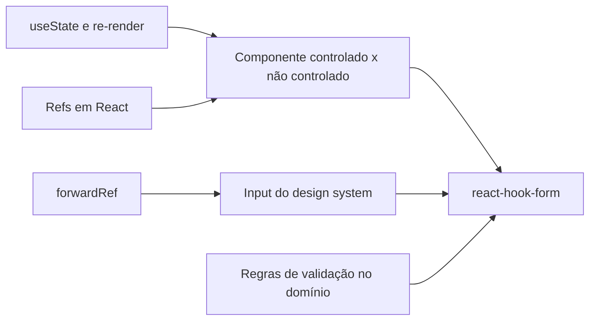

# Estudo: react-hook-form (formulários de login e cadastro)

> **Área:** React / formulários e validação · **Tipo de conhecimento:** tecnologia + conceitual · **Nível assumido:** você domina React (hooks, `useState`, props, refs) e TypeScript; já fez formulários com `useState` · **Tempo estimado:** 2 horas, em 2 sessões

**Arquivos do projeto que este estudo explica:** `app/(auth)/cadastro/{page.tsx,hooks/useCadastro.ts}`, `app/(auth)/login/{page.tsx,hooks/useLogin.ts}`, o componente `Input` do `@repo/ui` e `core/services/AuthService.ts`.

---

## 0. Antes de ler (5 minutos)

No tablet, sem consultar:

1. Num formulário feito com `useState`, o que acontece (re-render) a cada tecla digitada?
2. Validar só no navegador é suficiente para segurança? Por quê?
3. O que é um componente *controlado* e um *não controlado*?
4. O que acontece se o usuário clicar duas vezes rápido em "Entrar"?

---

## 1. Como estudar este tema

| Técnica | Como aplicar neste tema | Onde |
|---|---|---|
| Construir para aprender | Crie um formulário de 2 campos do zero (nome + senha) com `useForm`, sem olhar o projeto. | Editor |
| Prever antes de executar | Antes de enviar, preveja o conteúdo de `errors` e de `isSubmitting` em cada momento. | Navegador + DevTools |
| Quebrar de propósito | Tire o `ref` do `Input`, remova `handleSubmit`, deixe o `onSubmit` sem `async`. Anote o que quebra. | Editor |
| Diagrama à mão | Desenhe as 3 camadas de validação (cliente → domínio compartilhado → servidor) e onde cada erro aparece. | Tablet |
| Exemplo com lacunas | Exercícios da seção 7. | Tablet |

---

## 2. Visão geral

**Em uma frase:** `react-hook-form` gerencia o estado, a validação e o envio de formulários em React com poucos re-renders, e no projeto organiza os formulários de login e cadastro.

**Em um parágrafo:** em vez de guardar cada campo em `useState`, você "registra" os campos e a biblioteca lê os valores direto do DOM (campos **não controlados**), o que evita re-renderizar o formulário a cada tecla. Ela expõe `register` (liga um campo), `handleSubmit` (valida e chama o seu envio), `formState.errors` (erros por campo) e `setError` (para erros que vêm do servidor). No projeto, a validação reaproveita as regras puras do domínio (`AuthService`), que o servidor também usa.

---

## 3. Fundamentos necessários



**3.1 Re-render.** Cada mudança de `useState` renderiza o componente de novo. Em formulários grandes, digitar vira trabalho a cada tecla.

**3.2 Controlado x não controlado.** Controlado: o React dona do valor (`value` + `onChange`). Não controlado: o DOM guarda o valor e você lê quando precisa (via `ref`). O react-hook-form usa o modelo não controlado.

**3.3 Refs e `forwardRef`.** Para a biblioteca ler o `<input>`, ela precisa de uma `ref` dele. Se o `Input` é um componente seu, ele deve repassar a `ref` ao `<input>` interno. *Por que precisa:* sem isso, `register` não consegue ler o campo.

**3.4 Validação em camadas.** Validar no cliente melhora a experiência, mas **só o servidor é confiável**, porque qualquer pessoa pode chamar a API sem passar pelo formulário.

---

## 4. O conceito em profundidade

### 4.1 As peças principais

| Peça | O que faz |
|---|---|
| `useForm<T>()` | Cria o formulário e devolve as ferramentas abaixo. `T` tipa os campos |
| `register("campo")` | Devolve props (`name`, `onChange`, `onBlur`, `ref`) para ligar o `<input>` |
| `handleSubmit(fn)` | Impede o envio padrão, valida e só chama `fn(dados)` se for válido |
| `formState.errors` | Objeto com o erro de cada campo |
| `formState.isSubmitting` | `true` enquanto o `fn` assíncrono não termina |
| `setError("campo", {...})` | Define um erro manualmente (por exemplo, vindo do servidor) |
| `setError("root", {...})` | Erro geral do formulário (`errors.root`), sem campo específico |

### 4.2 Exemplo mínimo

```tsx
type Campos = { telefone: string; senha: string }

function Login() {
    const { register, handleSubmit, setError, formState: { errors, isSubmitting } } = useForm<Campos>()

    const onSubmit = async (dados: Campos) => {                  // 1. só roda se a validação passar
        const res = await fetch("/api/auth/login", {
            method: "POST",
            headers: { "Content-Type": "application/json" },     // 2. a API exige JSON
            body: JSON.stringify(dados),
        })
        if (!res.ok) setError("root", { message: "Telefone ou senha inválidos" }) // 3. erro do servidor
    }

    return (
        <form onSubmit={handleSubmit(onSubmit)}>
            <input {...register("telefone")} autoComplete="tel" />
            <input type="password" {...register("senha")} autoComplete="current-password" />
            {errors.root && <p role="alert">{errors.root.message}</p>}
            <button disabled={isSubmitting}>Entrar</button>      {/* 4. evita duplo envio */}
        </form>
    )
}
```

### 4.3 No projeto: validação reaproveitando o domínio

As regras (nome 3–80 caracteres, telefone com 10 ou 11 dígitos, senha de 8–128 com letra e número) vivem em `AuthService.ts`, uma função **pura** sem React. A mesma função roda em dois lugares:

```ts
// useCadastro.ts (cliente, para dar feedback rápido)
const errors = validateRegistration(dados)           // devolve { campo: mensagem }
Object.entries(errors).forEach(([campo, message]) => setError(campo as keyof Campos, { message }))

// register/route.ts (servidor, a validação que realmente importa)
const errors = validateRegistration(input)           // mesma função, sempre revalidada
if (Object.keys(errors).length) return jsonError(422, errors)
```

Assim, as regras não ficam duplicadas nem divergem. Se o servidor devolver 422 ou 409, o hook transforma a resposta em `setError` para mostrar a mensagem no campo certo.

### 4.4 O componente `Input` e o `forwardRef`

O `register` devolve uma `ref` que precisa chegar ao `<input>` real. Como o `Input` é do design system (`@repo/ui`), ele repassa a ref:

```tsx
const Input = forwardRef<HTMLInputElement, InputProps>(({ label, error, ...rest }, ref) => (
    <label>
        {label}
        <input ref={ref} aria-invalid={!!error} {...rest} />   {/* a ref chega ao <input> */}
        {error && <span role="alert">{error}</span>}
    </label>
))
```

Sem `forwardRef`, o `register` não acha o campo e o valor chega vazio ou `undefined`.

> Este trecho é um exemplo **ilustrativo** do padrão. Abra o `Input` real do `@repo/ui` e confira como ele repassa a `ref` (em React 19, `ref` também pode chegar como prop comum, sem `forwardRef`).

### 4.5 Boas práticas de segurança em formulários de senha

| Prática | Motivo |
|---|---|
| `type="password"` | Oculta a digitação |
| `autoComplete="current-password"` (login) e `"new-password"` (cadastro) | Gerenciadores de senha preenchem e sugerem senha forte corretamente |
| Nunca guardar a senha em estado global, `localStorage` ou log | A senha só existe no campo e na requisição |
| `disabled={isSubmitting}` | Evita duplo envio (dois cadastros ou duas tentativas) |
| Mensagem de erro genérica no login | Não revela se o telefone existe |
| Limpar o campo de senha após falha (opcional) | Evita que fique visível para quem estiver perto |

### 4.6 Exemplo trabalhado: o ciclo de um envio

1. O usuário digita: **sem re-render** do formulário (campos não controlados).
2. Clica em "Cadastrar": `handleSubmit` impede o envio nativo da página.
3. A validação do cliente roda. Se houver erro: `errors` é preenchido, o `onSubmit` **não** é chamado, o foco vai ao primeiro campo com erro.
4. Se válido: `isSubmitting` vira `true`, o `onSubmit` faz o `fetch`.
5. Resposta **201**: atualiza o usuário no contexto (`refreshUser`) e navega para `/bem-vindo`.
6. Resposta **409** (telefone já existe) ou **422**: `setError` mostra a mensagem. Resposta **429**: erro em `root` com a mensagem de espera.
7. `isSubmitting` volta a `false`, o botão reabilita.

### 4.7 Limites e contraexemplos

- **Validação do cliente não é segurança.** Quem usar `curl` ignora o formulário inteiro. Por isso o servidor sempre revalida.
- **Campos controlados:** quando você precisa do valor a cada tecla (máscara, contador), use `watch` ou `Controller`, que custam re-renders.
- **A biblioteca não valida sozinha as regras de negócio.** Aqui foi opção do projeto ligar o `AuthService`. Alternativas: `resolver` com Zod ou Yup.
- **Estado do `errors` some** se você recriar o formulário (`key` mudando) ou desmontar o componente.

### 4.8 Erros comuns

- Esquecer o `async` / `await` no `onSubmit`, e `isSubmitting` fica sempre `false`.
- Usar `register` em um componente próprio sem `forwardRef`.
- Chamar `register("nome")` com o nome errado e o campo não aparece nos dados.
- Validar só no cliente.
- Mostrar erros do servidor em um alerta do navegador em vez de `setError`.
- Colocar `autocomplete="off"` em senha (atrapalha gerenciadores de senha).
- Guardar a senha em `useState` além do formulário.

---

## 5. Conexões e confusões

| Par | Diferença |
|---|---|
| **Controlado x não controlado** | Controlado: React guarda o valor. Não controlado: o DOM guarda, o formulário lê quando precisa. O RHF usa o segundo por padrão. |
| **`register` x `Controller`** | `register` para inputs nativos. `Controller` para componentes que não expõem `ref` (selects customizados, bibliotecas de UI). |
| **Validação do cliente x do servidor** | Cliente: experiência. Servidor: segurança. As duas existem, a do servidor manda. |
| **`errors.campo` x `errors.root`** | Campo: erro de um input. Root: erro geral do formulário (ex.: credenciais inválidas). |
| **`handleSubmit` x `onSubmit` nativo** | `handleSubmit` valida e previne o envio padrão antes de chamar a sua função. |

---

## 6. Glossário

- **Componente controlado:** valor guardado no estado React.
- **Componente não controlado:** valor guardado no DOM.
- **`forwardRef`:** repassa a `ref` de um componente a um elemento interno.
- **`register`:** liga um campo ao formulário.
- **`handleSubmit`:** valida e executa o envio.
- **`setError`:** define manualmente um erro.
- **Resolver:** adaptador de validação (Zod, Yup).
- **Re-render:** nova execução do componente após mudança de estado.

---

## 7. Autoteste

1. Por que o react-hook-form causa menos re-renders que `useState` por campo?
2. O que é necessário para `register` funcionar em um `Input` do design system?
3. O que acontece se a validação do cliente passar, mas o servidor responder 409?
4. Por que o servidor revalida se o cliente já validou?
5. Para que serve `isSubmitting`? Cite dois usos.
6. Qual a diferença entre `errors.telefone` e `errors.root`?
7. Quais valores de `autoComplete` usar em login e em cadastro, e por quê?
8. Onde mora a regra "senha com 8 a 128 caracteres, com letra e número", e quem a usa?

**Lacunas A.** Complete o formulário:

```tsx
const { /* ??? 1 */, handleSubmit, formState: { errors, /* ??? 2 */ } } = useForm<Campos>()

<form onSubmit={/* ??? 3 */(onSubmit)}>
    <input {...register(/* ??? 4 */)} type="password" autoComplete="current-password" />
    <button disabled={isSubmitting}>Entrar</button>
</form>
```

**Lacunas B.** Complete o tratamento de erro do servidor:

```tsx
if (res.status === 409) setError("telefone", { /* ??? 1 */: "Telefone já cadastrado" })
if (res.status === 429) setError(/* ??? 2 */, { message: "Muitas tentativas. Tente mais tarde." })
```

### Gabarito

1. Os campos são não controlados: o valor fica no DOM e a biblioteca só o lê no envio ou na validação, sem atualizar estado a cada tecla.
2. O `Input` precisa usar `forwardRef` e repassar a `ref` ao `<input>` interno.
3. `handleSubmit` chama o `onSubmit`, que recebe 409 e usa `setError("telefone", ...)` para mostrar a mensagem no campo.
4. O cliente pode ser contornado (curl, scripts). Só a validação do servidor é confiável; a do cliente é conveniência.
5. Indica que o envio está em andamento. Usos: desabilitar o botão (evita duplo envio) e mostrar um indicador de carregamento.
6. `errors.telefone` é o erro daquele campo; `errors.root` é um erro geral do formulário (ex.: "telefone ou senha inválidos").
7. Login: `current-password`. Cadastro: `new-password`. Permitem que o gerenciador de senhas preencha ou sugira corretamente.
8. No `AuthService` (função pura do domínio). É usado pelo hook do formulário (cliente) e pela rota de API (servidor).

**Lacunas A:** 1) `register` 2) `isSubmitting` 3) `handleSubmit` 4) `"senha"`.
**Lacunas B:** 1) `message` 2) `"root"`.

---

## 8. Revisão seção por seção

A revisão é feita no próprio documento, seção por seção.

Método em cada revisão, **uma seção por vez**:

1. Leia só o título da seção e **cubra o texto** (com a mão ou com uma folha).
2. Responda a pergunta de recuperação da tabela abaixo **por escrito, no tablet**, sem olhar.
3. Descubra o texto e compare. Marque ✔ (acertei) ou ✗ (errei ou esqueci) na margem.
4. Reescreva **só a parte errada** com suas palavras. Seções ✗ voltam primeiro na próxima revisão.

| Seção | Pergunta de recuperação (responda cobrindo o texto) |
|---|---|
| 2 e 3 | Por que campos não controlados causam menos re-renders que `useState` por campo? |
| 4.1 e 4.2 | Para que servem `register`, `handleSubmit`, `errors`, `isSubmitting` e `setError`? |
| 4.3 | Como o `AuthService` é reaproveitado no cliente e no servidor? Por que o servidor revalida? |
| 4.4 | Por que o `Input` precisa repassar a `ref` ao `<input>` real? |
| 4.5 | Liste 4 boas práticas de segurança para campos de senha. |
| 4.6 | Narre o ciclo de um envio: digitar, validar, `isSubmitting`, respostas 201, 409, 422 e 429. |
| 4.7 | Liste os limites: validação do cliente, campos controlados, resolvers, estado de `errors`. |

> Dica: se quiser anotar com a caneta direto no documento, exporte para PDF e use um app de anotação no tablet.

---

## 9. Plano de revisão

Todas as revisões seguem o método da seção 8. O foco muda a cada data:

| Quando | Seções a revisar | O que fazer além do método |
|---|---|---|
| Dia 1 | Todas, na ordem | Monte o formulário mínimo da 4.2 digitando, sem copiar. |
| Dia 3 | Só as marcadas ✗ + 4.3 e 4.6 | Redesenhe as 3 camadas de validação de memória. Refaça as lacunas da seção 7. |
| 1 semana | Todas | Autoteste inteiro. Quebre de propósito: remova a `ref` do `Input` e observe. |
| 2 semanas | 4.2 a 4.6 | Abra `useCadastro.ts` sem o estudo e explique cada linha, incluindo 409, 422 e 429. |
| 1 mês | Marcadas ✗ + 4.7 | Construa um formulário novo (ex.: alterar senha) com validação compartilhada com o servidor. |

Se uma seção sair ✗ duas vezes seguidas, releia-a inteira antes de seguir. Releitura passiva do documento todo não conta como revisão.

---

## 10. Para aprofundar

- Documentação do react-hook-form (react-hook-form.com): `useForm`, `register`, `handleSubmit`, `setError`, `Controller`.
- Documentação do React: `forwardRef` e componentes controlados e não controlados (react.dev).
- MDN, *HTML attribute: autocomplete*.
- OWASP, *Input Validation Cheat Sheet* (validação no servidor).
